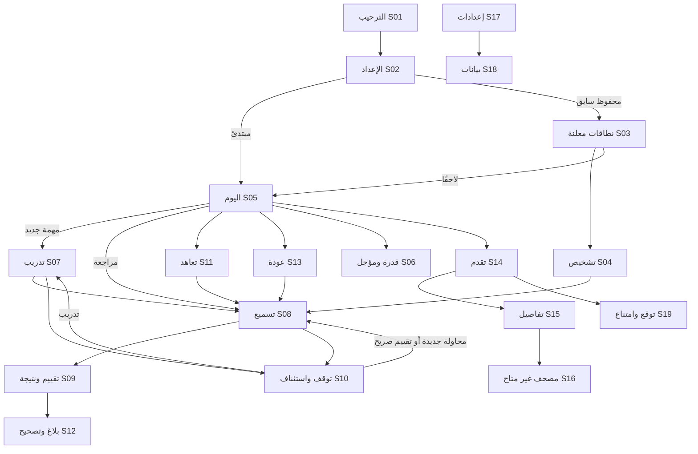

# نظام التصميم ومواصفة التفاعل 04-B

مرجع التنفيذ `src/components.tsx` و`src/App.tsx` و`src/catalog.ts` وملف الأنماط. هذه مواصفة تسليم للنموذج المنفذ؛ اعتماد تفاصيل قراءة المصحف مؤجل حتى توفر الخط والنص والطبعة المعتمدين.

## الهوية والتكوين

الهوية المحفوظة من طلب 04-B: عاجي دافئ للخلفيات، أخضر هادئ للإجراء الأساسي، أزرق ليلي للنص والبنية، ولمسات ذهبية محدودة. الأسطح والحدود واللون تساعد التدرج؛ نص الحالة يبقى ضروريًا ولا يتوقف المعنى على اللون. الوضع الداكن يغير الرموز اللونية ويحافظ على دلالة المكونات.

التطبيق عربي `lang=ar` و`dir=rtl`. على الشاشات الواسعة تعرض قائمة جانبية من اليمين؛ على الهاتف تعرض الوجهات الأربع أسفل الشاشة: اليوم، المصحف، التقدم، الإعدادات. حالات الجلسة والبيانات تبقى ضمن المسارات، وليست تبويبات إضافية. أدوات الفحص منفصلة في قسم مطوي يتيح الوصول للشاشات وحالات التعذر.

الأولوية البصرية: عنوان واضح؛ وصف قصير؛ حالة مؤثرة؛ عمل أساسي؛ تفاصيل السبب عند الطلب. النموذج يعلن أنه تجربة واجهات، والمراجع والنتائج غير المتاحة تذكر بصراحة. لا تزاحم رسائل المصدر فعل التسميع بعبارات تقنية؛ التفاصيل في أدوات الفحص والمساعدة.

## رموز التصميم المنفذة

| الرمز | فاتح | داكن | الاستخدام |
|---|---|---|---|
| `--bg` | `#f6f5ef` | `#172724` | خلفية الصفحة |
| `--surface` | `#fffefa` | `#20332e` | البطاقات والنوافذ والمدخلات |
| `--text` | `#253f45` | `#e0e9d9` | النص الأساسي الأزرق الليلي |
| `--muted` | `#64716b` | `#b5c5b4` | النص الثانوي |
| `--green` | `#235b47` | `#bed1a1` | الإجراء والربط والوسوم |
| `--green-dark` | `#123e34` | `#102b25` | البنية الجانبية |
| `--line` | `#dde2d8` | `#425449` | فصل الأسطح |
| `--gold` | `#b79046` | لمسات محدودة | زخرفة/تركيز لا حالة منفردة |
| لون المراجعة | `#526777` | لون متكيف مع المظهر | لمسة زرقاء رمادية على بطاقة المراجعة |
| `--danger` | `#a53535` | `#f2b4ad` | خطأ وحذف مع تسمية |

الخطوط محلية من النظام: Tahoma ثم Geeza Pro ثم Arial، دون تحميل خط من شبكة. هذا خط UI وليس اعتمادًا لخط مصحف. حجم الجذر 15px (14px للهاتف الصغير)، وخيار النص الكبير 20px؛ العناوين rem لإعادة التدفق. تباعد الأسطح 20px غالبًا، وحشو البطاقات 26px يتدرج إلى 19–22px للشاشات الصغيرة، وزوايا 8px للأزرار و13–16px للأسطح. حد الزر المعتاد 46px، والمدخل 47px؛ تفاصيل الاستثناءات والتحقق في QA. لا تعني هذه الأبعاد اجتياز حد لمس أصلي على كل جهاز.

نقاط الاستجابة الفعلية: 360، 640، 850، 1100، و1550px. عند 850px تتحول الملاحة إلى شريط سفلي، وعند 640px تصير أعمدة المحتوى عمودًا واحدًا، وتبقى شبكة الأجزاء 5 أعمدة صغيرة. قيم التباين النهائية ونتائج أي إصلاحات في تقرير QA؛ لا توصف جميع ألوان الحدود بأنها اجتازت معيارًا دون قياس.

## مكتبة المكونات الفعلية

| المكون | المصدر | وظيفته وحالاته | قاعدة الاستخدام |
|---|---|---|---|
| Button | `src/components.tsx` | primary / secondary / ghost / danger؛ disabled حيث يوجد مانع | فعل محدد؛ الأيقونات المنفردة لها اسم متاح؛ لا نجاح من الضغط وحده |
| Card | المصدر نفسه | سطح تجميع مع `data-component-id` عند الحاجة | لا توحي البطاقة بأنها قابلة للنقر ما لم تكن زرًا فعليًا |
| Notice | المصدر نفسه | info / warning / error / success | الخطأ يحمل `role=alert`؛ يشرح أثر التعذر؛ لا لون وحده |
| Empty | المصدر نفسه | عنوان وشرح وفعل ملائم | لا تساوي الحالة الفارغة صفر إتقان |
| Field | المصدر نفسه | label مرتبط بالمدخل ومساعدة اختيارية | أخطاء عددية ظاهرة؛ القيمة غير المعلومة لا تتخذ صفرًا حكمًا |
| Heading | المصدر نفسه | h1 ووصف ورجوع | العنوان يستقبل التركيز بعد التنقل دون دخوله ترتيب Tab المعتاد |
| Modal | المصدر نفسه | dialog أصلي مع عنوان وإغلاق | حصر تفاعل النافذة وفق المتصفح؛ Escape للإلغاء؛ إعادة التركيز لمصدر الفتح |
| Meta | المصدر نفسه | شارة نصية للمصدر/الحالة | النص يكفي لفهمها دون لون |
| Page | `src/App.tsx` | قالب عنوان ومحتوى للشاشات | `data-screen=Sxx` ومعرف `Sxx-<name>` قابلان للتتبع والفحص |
| ContentUnavailable | `src/App.tsx` | حالة غياب النص المعتمد | لا رسم حروف أو آيات بديلة؛ لا استماع أو تفسير مصطنع |

رموز الأيقونات من lucide-react، ولا تحمل بمفردها نصًا قرآنيًا أو نتيجة. مكتبة المكونات جزء من المشروع، ويمكن تشغيلها عبر الشاشات وأدوات الفحص؛ لا تعتمد على ملف تصميم خارجي غير متاح.

## المقاسات والإتاحة

المقاسات والألوان الفعلية في CSS هي مصدر الحقيقة، وتفحص على خمسة أحجام في تقرير QA. لا يحوّل قياس CSS px إلى اجتياز تلقائي لحدود pt/dp الأصلية على iOS/Android. أهداف المنتج للإنتاج من PRD هي 44pt و48dp، ثم تختبر على الأجهزة الحقيقية.

يدعم النموذج تفضيل النص الأكبر وتقليل الحركة والوضع الداكن. يجب أن ينجح تكبير المتصفح 200% وإعادة التدفق دون فقد فعل أساسي؛ نتيجة الفحص الفعلية في QA. اعتماد قارئ الشاشة لا يستنتج من التسميات أو axe: يلزم VoiceOver وTalkBack يدويان، ثم إعادة الاختبار مع المحتوى المرجعي.

## خريطة التدفقات

الرسم يبين الوجهات، لا أهلية تعلم. جميع جلسات النموذج تمثيلية. تسمية «محاولة جديدة» بعد انقطاع لا تصل مقطعين زمنيين في دليل متصل واحد؛ السابقة تبقى غير مكتملة. «كنت قد أنهيت التسميع» يسمح بتقرير ذاتي مع `timingUnverified`.

## حالة المنتج والتخزين

المسار العام: فعل المستخدم → `transition` → تحقق الحالة → محاولة الكتابة `savePrototype` → تحديث واجهة الحالة بعد نجاح الكتابة. الحفظ المتعذر يبقي آخر حالة مؤكدة ولا يمنح إيصال نجاح. البيانات محفوظة في LocalStorage تحت مفتاح بإصدار؛ هذه مساحة نموذج غير مشفرة، ويمكن لمحو بيانات المتصفح حذفها. لا يمثل السجل قاعدة أحداث معتمدة أو ضمان استعادة بعد عطل جهاز.

| الفعل | التغير التجريبي | ما لا يُنشأ |
|---|---|---|
| إعداد وقت/أيام/هدف | config وrevision | محاولة أو إتقان |
| وقت هذا اليوم فقط | todayBudget بتاريخ محلي وrevision؛ معاينة ثم اعتماد؛ config.minutes/days والسجل باقية | خطة HME جديدة أو حساب زمن منفق أو احتياط من UI |
| إضافة محفوظ متفرق | ranges معلنة unassessed؛ اتحاد تداخل داخل المحور نفسه | نطاقات في الفجوات؛ نجاح؛ تحويل صفحات بلا خريطة |
| تكرار | repeats بعد تأكيد الحفظ | RecallAttempt أو درجة FSRS |
| بدء تسميع | attemptId وفرصة وعنقود، مصدر V1 | حكم صحيح أو فاصل معتمد |
| طلب تلميح/كشف | hints/revealed تحفظ فورًا | محو المساعدة عند إخفاء العرض |
| بلاغ خطأ | MistakeDraft يقبل null والاشتباه | لفظ منطوق مختلق أو Again من الشك |
| إنهاء وتسليم تقييم | تقرير صريح/متنازع، حقول مجهولة باقية | strictPass أو effectiveRating؛ كلاهما null |
| تصحيح | Correction مرتبط بالأصل ونسخته | محاولة جديدة أو وقت تعلم يوم التصحيح |
| إيقاف/إغلاق | checkpoint ومحاولة غير مكتملة | فشل ذاكرة تلقائي |
| حذف كامل | هوية جديدة وسجل تجريبي فارغ؛ مسح استثناء ميزانية اليوم؛ تفضيلات وإعداد معتاد معلن بقاؤهما | نجاح/فشل أو حذف النسخ الخارجية |

كل نطاق يحمل `editionId=prototype-unverified` ووسمًا يوضح أنه إدخال معلق. الصفحة تحمل layoutId تجريبيًا. فحص حدود الآيات الحالي فحص إدخال عددي فقط؛ لا يدعي التحقق من نهاية آية أو صحة وقف. لا يعرض مجموع كلمات بين سورة وجزء وصفحة لغياب الخريطة المعتمدة.

ميزانية اليوم في S06 منفصلة عن الوقت المعتاد: `{localDate, minutes}` تحفظ بأمر `plan.todayBudget` ضمن نسخة الحالة المحلية. التاريخ في النموذج وفق `Asia/Riyadh`؛ يسري الاستثناء عندما يطابق تاريخ اليوم، وإلا يرجع العرض إلى `config.minutes` دون إعادة كتابة أيام النشاط أو المحاولات. المعاينة والإلغاء لا يكتبان، وفشل الحفظ يبقي النسخة المؤكدة. الصفر يخلي قائمة مهام اليوم التمثيلية ويحفظ الالتزامات السابقة في المؤجل مع أصل الاستحقاق؛ لا يضيف للمبتدئ مراجعات لم يصرح بها. هذا اختيار ميزانية وعرض fixtures، وليس خوارزمية تعيد حساب المنفق أو تحجز الاحتياط أو تقرر موعدًا جديدًا؛ تبقى هذه وظائف C04 الإنتاجي.

## حالات التشغيل والأخطاء

| الحالة | مجالها | السلوك المطلوب/الممثل |
|---|---|---|
| loading | أداة فحص عامة للشاشات | نص جارٍ التحميل، دون أصفار أو نتيجة تعلم؛ إنهاء المحاكاة بفعل واضح |
| error | أداة فحص عامة | تعذر قراءة مع إعادة المحاولة؛ الحالة السابقة باقية |
| empty | الخطة/القوائم | شرح غياب المهام/البيانات؛ لا اكتمال تلقائي |
| capacity | اليوم/الخطة | عجز معلن ومؤجل؛ لا حذف أصل الاستحقاق |
| offline | رسالة عرض تجريبية | توضح حدود المحتوى؛ الاختبار الشبكي الفعلي منفصل في QA |
| saveFailure | حقن فشل كتابة | لا انتقال يزعم الحفظ؛ إعادة المحاولة بعد إزالة السبب |
| invalid input | الوقت/الأيام/النطاق | لا حفظ قيم غير صالحة؛ تصحيح بجوار المدخل |
| incomplete/disputed | محاولة/تقييم/خطأ | حفظ المجهول والاشتباه؛ لا استنتاج نجاح أو فشل |
| corrupt/foreign import | S18 | فحص قبل الاستبدال؛ الحالي باق؛ لا دمج |
| missing content/media | S01/S07/S16/S17 | الامتناع الصريح عن نص/صوت/تفسير بديل |
| insufficient forecast | S19 | آجال 1/3/6/12 شهرًا غير متاحة، دون تاريخ مختلق |

هذه لغة حالات واجهة، وليست تنفيذًا لجميع أعطال القاعدة والمنصة. الأخطاء العقدية الإنتاجية موجودة في C interfaces؛ اختبار clock/replay/migration/atomicity مطلوب عند تنفيذها.

## بيانات السيناريوهات

`src/domain/mock.ts` يوسم المصدر `mock` و`learningEvidence=false`. للمبتدئ دون محفوظ في الحالة العادية مهمة تدريب تمثيلية واحدة N1؛ لا ينشئ له مراجعات أو معالجة أو تشخيصًا سابقًا، ولا مجموع وقت مقدر أو مواعيد شخصية. أما أمثلة المحفوظ السابق فتواريخ لقطتها الصناعية ثابتة وموسومة، ولا تُقدم بوصفها خطة شخصية محدثة. مثال الحمل الوحيد ذو مجموع معلوم مأخوذ من HME §19 ب: 30/60/120 دقيقة ↔ 25/49/97 دقيقة مخططة. اختيار أوقات أخرى لا ينشئ مجموع HME من حساب واجهة. وضع المحافظة على المحفوظ/المحفوظ الكامل يستبعد الجديد. بيانات التقدم التعليمية والتوقعات null؛ عدد تفاعلات النموذج لا يحول إلى إتقان.

C01 المحتوى غير متاح؛ C03 عينة عرض من المدخلات لا اختيار تشخيص علمي؛ C04 لقطة ثابتة؛ C05 checkpoint؛ C06 عداد؛ C07 تقرير بلا تفسير محرك؛ C08 مسودات؛ C09 حالات مجهولة؛ C10 امتناع؛ C11 تفضيلات بلا هجرة؛ C12 فحص ملف تجريبي؛ C13 بلا جدولة نظام؛ C14 بلا وسائط. أسماء العقود الدقيقة في `src/domain/contracts.ts`.

## التسليم للبرمجة

يستبدل فريق 05 محولات Mock تدريجيًا مع الحفاظ على القوالب والمعرفات وحالات التعذر. تحقق المحتوى يسبق أي تعلم؛ إيصال البيانات يسبق عبارة «حُفظ»؛ واجهة C07 الإنتاجية وحدها تفسر الأهلية؛ C04 وحده يختار الترتيب والمواعيد؛ C09 يحل التغطية عبر النص المعتمد؛ C12 الإنتاجي يحتاج التشفير والمعاملات؛ C13/C14 يتكاملان مع المنصة وفق بواباتهما. تظل اختبارات عدم الادعاء والتصحيح والاستئناف اختبارات انحدار بعد الربط.
