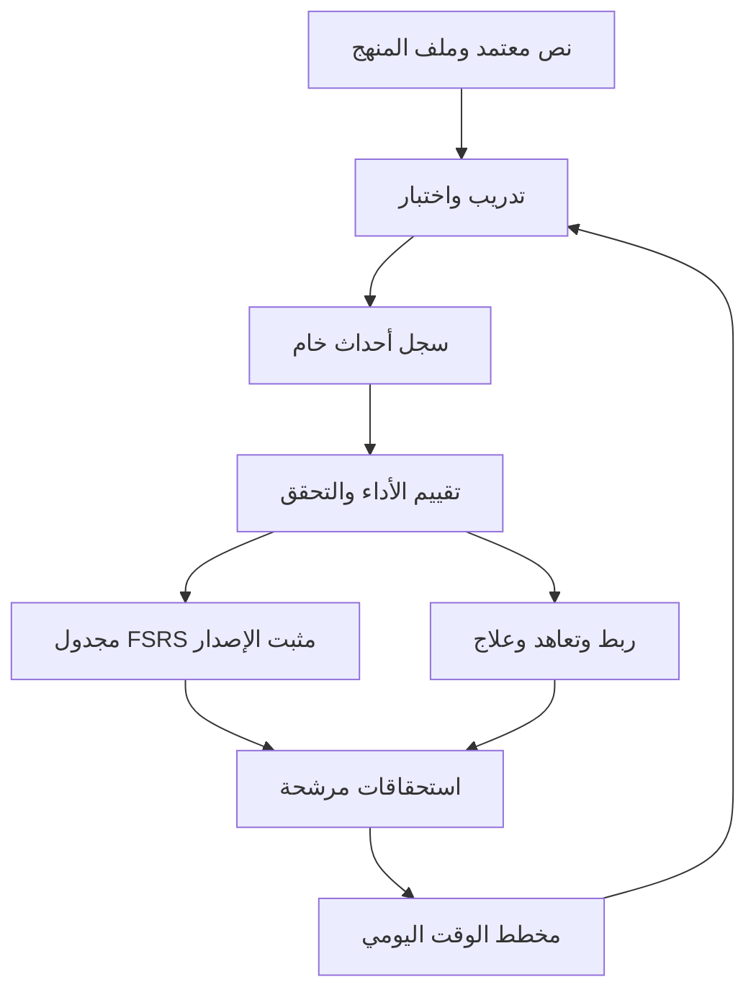

**النسخة:** HME 0.1 للمراجعة العلمية والهندسية. **تاريخ التدقيق:** 5 نوفمبر 2026، بتوقيت الرياض. **النطاق:** مواصفات محرك محلي للحفظ والتسميع والمراجعة؛ لا يتضمن بناء التطبيق أو تصميم شاشاته.

القرار المقترح هو بناء **محرك هجين قابل للاختبار**: اكتساب أولي، ثم استرجاع مؤجل، ثم جدولة تكيفية داخل دورة تعاهد متصل. تُحفظ صحة الألفاظ والربط والطلاقة وموثوقية القياس منفصلة عن احتمال الاسترجاع الذي يقدره المجدول. لا تمثل هذه المواصفات إثباتًا لتفوق المنهج المقترح على مناهج التحفيظ، ولا تصف «الإتقان» بأنه حالة نهائية.

قُرئت الدراسة التأسيسية كاملة بعد أن أتاح صاحب المشروع النص كاملًا، وقُرئ طلب البرومبت 02 كاملًا. رموز الاستشهاد الداخلية في الدراسة ليست روابط قابلة للتحقق؛ لذلك استُبدلت في القرارات المركزية بمراجع مباشرة. تُعامل أوصاف المنافسين في الدراسة كسياق منتج، ولا يُبنى عليها إثبات علمي للمحرك.

# 1 تصنيف الأدلة وتصحيح الدراسة التأسيسية

تستخدم الوثيقة خمسة أوصاف ثابتة: **دليل عام** لنتيجة بحثية في المهمة المدروسة، **ممارسة موثقة** لما تقرره جهة تعليمية، **استنتاج** لنقل محدود من الدليل، **قرار هندسي** لبنية النظام، و**فرضية معايرة** لكل عدد أو وزن أو حد اختير للتجربة. كل قيمة افتراضية خاصة بـHME أدناه، ولو كانت معقولة، فرضية معايرة ما لم تُنسب صراحة إلى مصدر أو تعريف رياضي.

| القضية التي ناقشتها الدراسة | التصنيف بعد المراجعة | القرار في المحرك |
|---|---|---|
| الاسترجاع والتباعد أساسان للاحتفاظ | دليل عام قوي، لا يحدد جدولًا قرآنيًا بعينه | اختبار غيبي مع مراجعات مؤجلة وتصحيح |
| كفاية التكرار الكثير لإثبات الثبات | رفضتها الدراسة؛ لا يستنتج الثبات من العدد وحده | التكرارات تسجل تدريبًا، ولا تمنح انتقالًا زمنيًا بمفردها |
| المنهج الهجين هو الأنسب | ترجيح تصميمي واعد، وليس تفوقًا تجريبيًا مثبتًا | يختبر مقابل دورة ثابتة وFSRS مع عبء زمني متكافئ |
| «FSRS معدل» | عبارة ملتبسة | نواة FSRS أصلية مثبتة الإصدار، وتكييف قرآني خارجي مسمى HME |
| FSRS هو الأقوى للمشروع | لا توجد مقارنة قرآنية كافية لإطلاق الحكم | مرشح مفتوح مناسب؛ يبقى خط أساس ثابت بديلًا |
| هرم الآية والمقطع والصفحة والجزء | مفيد مفاهيميًا، لكنه ليس شجرة احتواء صافية | نطاقات نصية ثابتة وعلاقات متعددة؛ الصفحة قد تقطع الآية والسورة قد تتجاوز الجزء |
| خفض وزن التقييم الذاتي | يحتاج تحديدًا؛ تعديل تحديثات FSRS بالوزن يغير النموذج | لا نضرب تحديث FSRS بمعامل ثقة؛ نضبط أهلية الحدث وسقف الفاصل ونوع الدليل خارجه |
| إعادة بناء Stability بعد الغياب | لا يجوز اختراع أحداث فشل | يتناقص R بمرور الوقت؛ S وD يتغيران عند حدث مؤهل أو إعادة تشغيل التاريخ |
| سقف تعاهد القديم | قيد تربوي مقترح | يُحسب مع القدرة الزمنية؛ التعارض يكشف ولا يخفى |
| مجانية محلية | تقلل كلفة التشغيل، لا تثبت الاستدامة المالية وحدها | جميع قرارات النواة تعمل بلا خادم؛ تكلفة المحتوى والصيانة خارج هذا التقرير |
| 90% احتفاظ | هدف تنبؤي لنتيجة اختبار محددة | لا يعني إتقان 90% من ألفاظ القرآن أو صحة التجويد |

الإصدار الأول المستخلص من الدراسة: رواية حفص عن عاصم بمصدر محدد، نص ثابت موثق، إدخال المحفوظ السابق، تخطيط يومي، تدريب واسترجاع ذاتي، مراجعة مبكرة وتكيفية ومتصلة، سجل أخطاء، تشخيص واستعادة، عمل محلي وإشعارات محلية. تؤجل القراءات العشر، التجويد الآلي، التعرف الصوتي الشامل، إدارة الحلقات والشبكات الاجتماعية. يُحفظ باب التوسع في المعرفات والبيانات دون بناء هذه الوظائف الآن.

المسائل المفتوحة الباقية: طول المقطع، العدد الأدنى للتدريب، عدد النجاحات المستقلة، تعريف التردد، حدود الثقة، سقف التعاهد، وحدات الجدولة، هدف الاحتفاظ، أثر الربط، ومعاملات المستخدم. لا تُحسم بتحويلها إلى ثوابت غير قابلة للتغيير.

# 2 ما تثبته أبحاث التعلم وما لا تثبته

الاسترجاع أداة تعلم وقياس معًا. وجدت تجربة Roediger وKarpicke أن أثر الاختبار ظهر في الاحتفاظ المؤجل مقارنة بإعادة الدراسة؛ لكنها قيّمت وحدات معنى في نصوص نثرية، ولم تشترط استنساخ الألفاظ والترتيب كما في القرآن. يدعم ذلك إدراج التسميع، ولا يثبت عتبة نجاح قرآنية أو عدد تسميعات بعينه. [الدراسة الأصلية 2006](https://doi.org/10.1111/j.1467-9280.2006.01693.x)

تجربة Cepeda وزملائه تربط أفضل فاصل مراجعة بالأفق الزمني للاحتفاظ. لذلك تُرفض صيغة «1 ثم 3 ثم 7 ثم 14 ثم 30 يومًا قانون للجميع»؛ يجوز اختبارها كخطة بداية. الاختبار نفسه يغير الذاكرة، لذا يجب أن تكون اختبارات المقارنة متساوية بين المجموعات. [تجربة التباعد 2008](https://doi.org/10.1111/j.1467-9280.2008.02209.x)

محدودية عائد التدريب الزائد في بعض المهام لا تثبت أن أربعين تسميعًا غير مفيد للقرآن. سؤال التجربة المناسب هو: هل ينتج العدد الثابت احتفاظًا لفظيًا واتصالًا أفضل من توزيع زمن مكافئ على الاسترجاع المؤجل؟ [تجربة التدريب الزائد 2005](https://doi.org/10.1002/acp.1083)

اختبارات المزج بين أمثلة متشابهة قد تساعد على التمييز في مواد معينة؛ نقلها إلى المتشابهات القرآنية **فرضية**. يبدأ التدريب بمقارنة موضعين مدققين ثم استرجاعهما في سياقهما، ولا يتحول الحفظ الأولي إلى تنقل عشوائي بين السور. [تجربة المقارنة التمييزية 2013](https://doi.org/10.3758/s13421-012-0272-7)

لا يترتب على هذه الأدلة إثبات أن النموذج يحاكي الترسيخ العصبي أو يقيسه. كلمة Consolidating في الحالة التشغيلية تعني توافر أدلة استرجاع مؤجل ضمن قواعدنا؛ لا تعني قياس عملية عصبية.

# 3 البنية العامة وحدود الطبقات

لا حاجة إلى تسع خدمات منفصلة أو اتصال شبكي بينها. الأنسب للإصدار الأول مكتبة محلية واحدة ذات وحدات منطقية، ومعاملة بيانات واحدة لكل محاولة. يمكن دمج الحفظ والتكرار في وحدة تدريب، والقريب والمتباعد والتعاهد في وحدة سياسات جدولة، مع إبقاء واجهاتها منفصلة للاختبار.

| الطبقة المطلوبة | المدخلات | المخرجات والمسؤولية | العلاقة |
|---|---|---|---|
| Acquisition | النص المعتمد، المستوى، وقت الجلسة | مقطع مناسب وخطوات تهيئة واختبار | يستدعي Repetition ولا يقرر الإتقان البعيد |
| Repetition | المحاولات والأخطاء والتعب | تدريب تالٍ أو توقف أو جاهزية اختبار | لا يولد نجاح مراجعة من العداد |
| Early Review | أول استرجاع وتواريخ الاختبارات | استحقاقات قريبة ومعيار تخرج | يضع قيدًا خارجيًا على موعد النموذج |
| Spaced Scheduler | حالة ذاكرة وتقييم مؤهل وزمن | حالة FSRS جديدة وموعد خام | لا يعرف أحكام التجويد أو حدود الصفحة |
| Continuity | روابط ونطاقات وتسميع مسجل | ضعف اتصال ومهام ربط وتغطية | يميز السياق من البدء المستقل |
| Maintenance | كل المحفوظ ووقت تعاهده | دورة تغطية وموعد أقصى مستهدف | يراجع جدواها مع المخطط |
| Mastery Assessment | أدلة خام وأبعاد ومصدر التحقق | ملف أداء متعدد الأبعاد وثقة وصفية | يمنع الترقية غير المدعومة |
| Daily Planning | جميع المرشحين والوقت والتوقعات | ورد قابل للتنفيذ وأسباب وتأجيلات | يختار المهام ولا يغير الوقائع الماضية |
| Weakness Recovery | أخطاء متكررة وغياب وتشخيص | علاج موضعي وخطة عودة | لا يمحو حالة كل المحفوظ |



قاعدة الفصل: **الموعد الخام** تقدير النموذج، و**الموعد المطلوب تربويًا** ناتج السياسة، و**الموعد المخطط فعليًا** نتيجة القدرة الزمنية. تحتفظ البيانات بالثلاثة. لا يتغير موعد سابق في السجل لإخفاء التأخر.

# 4 نموذج النص ووحدات الحفظ

النص المرجعي غير مولد، ويثبت بمعرف إصدار وبصمة. يشترط Tanzil عند استخدام نصه نسبة المصدر والحفاظ على النص دون تغيير وإدراج إشعار الترخيص. يُفصل نص العرض المعتمد عن فهارس البحث أو المحاذاة؛ لا تستخدم إزالة التشكيل لتعديل الأصل. وتبقى الموافقة العلمية على الوقف والابتداء وبنية المصحف شرطًا للمحتوى. [ترخيص Tanzil الرسمي](https://tanzil.net/docs/text_license)

**TextEdition** يحدد الرواية والطريق إن كان محددًا بالمصدر، ونظام عد الآيات، والرسم والضبط، ومخطط تقطيع الكلمات، وإصدار المصدر وبصمته. لا يُملأ طريق الرواية بالتخمين. **MushafLayout** مستقل للطبعة والصفحات؛ ترقيم صفحة ليس معرفًا أبديًا للمحتوى.

الموقع القانوني هو `(editionId, surahId, ayahId, tokenIndex)`؛ تخزن النطاقات ببداية شاملة ونهاية غير شاملة. لا يعتمد الحد على موضع حرف في شاشة أو ملف قابل للتبديل. تستخدم الوحدة التي تعبر سورًا عدة قائمة نطاقات مرتبة، وتُشتق سورة البداية والنهاية للعرض.

| النوع | الاستخدام | هل يحمل مجدولًا دائمًا؟ |
|---|---|---|
| Atomic | آية أو جزء معتمد من آية طويلة؛ تحديد الخطأ | عند حاجة علاج مستقلة، وإلا يبقى مؤشرًا نصيًا |
| Chunk | نطاق صغير ثابت الهوية للاكتساب والاختبار | نعم؛ هو وحدة الجدولة الأساسية المبدئية |
| Continuity | نطاق متصل أو صفحة أو عدة صفحات | سجل اتصال وتغطية؛ مجدول خاص فقط لاختبار متكرر محدد النوع |
| Maintenance | سورة أو ربع أو حزب أو جزء | التزامات دورة تعاهد، لا نسخ FSRS لكل طبقة افتراضيًا |

تُخزن عضوية الوحدة في جدول علاقات مع نوع العلاقة: احتواء، تداخل، تجاور، ارتباط تعاهد. يشترط خلو علاقات الاحتواء من الدوران. الصفحة والجزء تصنيفات نطاقية، لا أبًا وحيدًا لكل مقطع. عدد الكلمات وزمن التلاوة المرجعي مشتقان مع `derivationVersion`؛ يحدد الزمن القارئ والسرعة والمصدر ولا يستخدم عقوبة على الترتيل البطيء.

عند تعديل حجم المقطع لا يُنقل S بالتناسب مع الكلمات. تُنشأ هوية جديدة، وتحفظ علاقة التقسيم أو الدمج، ويُعاد اشتقاق الأدلة التي تغطي النطاق بدقة؛ يبدأ مجدول جديد أو تاريخ قابل لإعادة التشغيل وفق سياسة هجرة موثقة. لا تساوي ذاكرة نصف الصفحة نصف Stability.

مثال: مقطعان A وB ينجح كل منهما عند البدء منه، لكن الانتقال A→B يفشل. تبقى أدلة دقة A وB، ويضعف رابطهما ووحدة الاتصال. لا يرفع متوسط درجاتهما حكم إتقان الصفحة. وقد ينجح B داخل السرد مع عجز البدء منه؛ لذلك يختلف `probeType=connected` عن `probeType=random_start`.

# 5 دورة الحياة ومعايير الانتقال

حالة سير العمل تحدد التدريب التالي. تقدير الإتقان يصف الأدلة الحالية. يوجد بجانبهما `verificationStatus` و`coverageStatus` و`attentionFlag`؛ لا نضيف حالات كثيرة لكل حاصل ضرب بينها. رمز **نجاح صارم** يعني إكمال النطاق المطلوب غيبًا، دون عرض أو تلميح ودون خطأ لفظي مرصود في المحاولة الأولى؛ التردد يسجل منفصلًا. هذا معيار منتج أولي، وليس حكمًا شرعيًا على صاحبه.

| الحالة | الدخول والتعريف | الخروج والاختبار | الأخطاء والرجوع | الجدولة والوصف |
|---|---|---|---|---|
| NotStarted | لم يسجل تعلم أو ادعاء حفظ | بدء تهيئة أو تشخيص محفوظ سابق | لا يوجد أداء للحكم عليه | لا موعد ذاكرة؛ «لم يبدأ» |
| Learning | تدريب أولي جارٍ | نجاحان صارمان في محاولتين منفصلتين دون عرض النص داخل الجلسة | الخطأ يسمح به للتعلم ويعيد عداد النجاح التدريبي؛ التعب يوقف الجلسة | استئناف تدريب؛ «قيد الحفظ» |
| InitialRecall | تحقق المعيار الأولي | إنشاء اختبار مؤجل ثم EarlyReview | لا تُستنتج ديمومة من نجاح اليوم | حالة قصيرة مثبتة بحدث؛ «استرجاع أولي تحقق» |
| EarlyReview | اختبار مؤجل مستحق | نجاحان في يومين مختلفين، آخرهما بعد فاصل ≥24 ساعة، ونطاق دليل ≥3 أيام | تلميح أو خطأ لفظي ينشئ NeedsReinforcement؛ تعثر محدود يعالج ثم يعاد الاختبار | سقوف مبكرة؛ «قيد المراجعة القريبة» |
| Consolidating | نجح في شرط المراجعة القريبة | 3 اختبارات صارمة في أيام منفصلة تمتد ≥14 يومًا، أحد الفواصل ≥7 أيام، مع اختبار اتصال ذي صلة ناجح | فشل مؤهل ينشئ علاجًا؛ ضعف الربط يوقف ترقية الوحدة الكبيرة | FSRS وسياسة تعاهد؛ «قيد التثبيت» |
| Maintenance | استوفى بوابات الثبات والربط الحالية | استمرار التعاهد؛ لا تخرج نهائيًا | فشل مباشر → NeedsReinforcement؛ قِدم الدليل يخفض حداثته ولا يختلق فشلًا | «ضمن التعاهد، بأدلة مؤرخة» |
| NeedsReinforcement | خطأ موضعي أو رابطة ضعيفة أو تعارض تقييم | تشخيص قصير وعلاج موجّه؛ نجاح مؤجل يعيد المرحلة المناسبة | لا تعمم خطأ الرابط على جميع الكلمات؛ فشل واسع متكرر → Relearning | أولوية إصلاح؛ تحفظ `previousPhase` |
| Relearning | فشلان واسعان في اختبارين مؤجلين بعد علاج، أو طلب المستخدم، وفق بوابة القسم17 | استرجاع أولي ثم EarlyReview | التدريب مجددًا دون مسح التاريخ | «إعادة تعلم هذا المقطع» |

جميع أعداد النجاح والأيام في الجدول فرضيات معايرة ضمن الملف P0. النجاح غير المتحقق بالكامل يسمح بتقدم سير التدريب مع وسم «تقييم ذاتي»، لكنه لا يولد شهادة إتقان موثوق. يكتفى بصفر أخطاء **مرصودة** عند المعيار؛ لا يُفترض أن الصفر يعني خلو الواقع من الخطأ إذا كان القياس ضعيفًا.

المحفوظ السابق يدخل بوسم `declared_known + unassessed` ولا يوضع آليًا في Maintenance. الغياب لا ينقل الوحدة إلى Relearning بذاته. «NeedsReinforcement» بسبب احتمال نموذج منخفض وحده يكون تنبيهًا للفحص، أما الانتقال العلاجي الكامل فيحتاج ملاحظة أداء.

عندما لا يوجد رابط خارجي تالٍ للنطاق المختبر، يسجل ذلك الرابط وحده `not_applicable`؛ تظل الروابط الداخلية واجبة القياس، ولا يمنح بعد الاتصال كله درجة 100. لا يُسمح بحالات أو درجات تنسب الحفظ إلى رواية غير التي اختُبرت.

# 6 القياس متعدد الأبعاد وموثوقية البيانات

| البعد | التعريف التشغيلي | المؤشر المسجل | ما يمكن في الإصدار الأول |
|---|---|---|---|
| Accuracy A | مطابقة الألفاظ والترتيب للنطاق المعتمد | حذف واستبدال وإضافة وقلب ترتيب وتصحح ذاتي؛ اكتمال التغطية | سجل يدوي أو مراجعة تسجيل؛ الصدق محدود بجودة المصحح |
| Fluency F | استرسال دون بحث طويل غير مطلوب أدائيًا | مدد توقف استرجاعي وبدايات مترددة، مع استثناء الوقف المشروع والتنفس | مؤقت وتوصيف يدوي؛ لا يساوي سرعة القراءة |
| Temporal evidence T | ثبات أداء مرصود عبر فواصل | عدد اختبارات مستقلة، أكبر فاصل ناجح، امتداد زمني، آخر نجاح | قابل للتسجيل؛ مختلف عن S الرياضي |
| Continuity C | الانتقال الصحيح بين نطاقين دون تلميح | نجاحات الروابط/الاختبارات المؤهلة، ونطاق الروابط المختبرة | رصد يدوي على انتقالات معلومة |
| Random Access X | البدء من موضع معين دون أن يُعطى أول لفظ | نجاح البداية والإكمال القصير، ونوع السؤال | اختبار عند بداية آية معتمدة، لا اقتطاعًا عشوائيًا مخلًا |
| Mutashabihat U | التمييز بين مواضع مدققة متشابهة | عدد التباسات موثقة ومقابلها اختبارات تمييز | يحتاج قاعدة مراجعة علميًا وتسجيل الخطأ الشخصي |
| Verification V | وصف مصدر القياس وتغطيته وحدوده | المصحح، المؤهلات/النموذج، النص المغطى، مواضع النزاع، تاريخ التدقيق | بيانات وصفية، لا يضاف إلى درجات الأداء كأنه مهارة |

تعريف تشخيصي للدقة، حيث N عدد كلمات المدى المرجعي الذي حاول المستخدم أداءه، بما فيها الكلمات المحذوفة، وe مجموع أخطاء المحاذاة غير المتداخلة:

```math
A=100\max(0,1-e/N),\qquad N>0
```

لا يكفي هذا المتوسط للنجاح: في مقطع 100 كلمة، خطأ واحد يعطي A=99 لكنه يفشل معيار «صفر خطأ». قلب الترتيب يسجل كنوع خطأ مع نقاط المحاذاة، ولا يضاف مرة ثانية إلى e إذا احتسب فيها. لا تُحسب دقة بقية مقطع لم يُسمع.

إذا أمكن تحديد زمن التوقف الاسترجاعي P والزمن الكلي Tt بصورة موثوقة، يمكن تجريب `F=100×max(0,1−P/Tt)`. هذا وصف لوقت الاسترجاع، وليس معيار تجويد. لا يستخرج المؤقت وحده P. تحفظ أعداد التوقفات ومددها بدل اختزالها مبكرًا.

لكل قيمة بنية `value, unit, denominator, observedAt, evidenceIds, status`. حالات القياس: measured، not_measured، not_applicable، disputed؛ ويحفظ مصدر التقييم V1–V4 في حقل منفصل. القيمة المفقودة `null`؛ الصفر يحتاج تصريحًا بالرصد، ولا يملأ افتراضيًا عند ترك الحقل فارغًا. يحسب `coverage=measuredRequiredDimensions/requiredDimensions`، مع تغطية تحقق مستقل منفصلة عن تغطية التقرير الذاتي، ويعرض نطاق النص المختبر إضافة إلى نسبة الأبعاد.

**مستويات التحقق:** V1 تقرير ذاتي؛ V2 تسجيل راجعه المستخدم؛ V3 مصحح آلي مُتحقق على نطاق معلوم؛ V4 معلم مؤهل. هذه فئات مصدر وليست ترتيبًا مضمونًا للدقة في كل حالة. V2 قد يفوت خطأ يسمعه المتعلم كما يحفظه، وV3 قد يضعف مع الضجيج أو الرواية غير المدعومة، وV4 يحتاج اتساقًا بين المقيمين. تؤجل قدرة V3 للإصدار اللاحق ولا تفترض موجودة في الإصدار الأول.

الأحداث V1/V2 المؤهلة يمكنها تحديث مجدول التشغيل، مع سقوف توسع واختبارات تحقق مستقلة ووسم ضعيف الثقة. لا توجد طريقة حسابية تمنع مستخدمًا من اختلاق كل سجله؛ الحماية تقلل الضرر وتمنع وصف إتقانه بأنه موثوق. لا يصح ادعاء اكتشاف التجويد أو المخارج من تطابق كلمات أو من زر «صحيح».

# 7 المؤشرات الرقمية وفصل الثقة عن الأداء

يحتفظ النظام بأربعة أشياء لا تُدمج في رقم مبهم:

1. **أداء الاختبار الأخير:** A وF والأخطاء والتلميحات، مع تاريخ ونوع اختبار.

2. **Retention estimate:** `Q_R(t)=100×R(t)` لوحدة ونوع اختبار محددين؛ تقدير نموذج غير معاير قرآنيًا في البداية.

3. **الثقة:** فئة وصفية ومعلومات تغطية وحداثة ومصدر؛ ليست احتمال صحة الرقم ولا شهادة للمتعلم.

4. **الإتقان القرآني:** متجه `(A,F,T,C,X,U;V)` وحكم مقيد بنطاق ووقت؛ لا يفترض من R.

يُمنع عرض `R(0)=100%` بعد تحديث النموذج على أنه «أداء كامل»، خصوصًا بعد فشل. هذه قيمة منحنى بعد إعادة التعرض، لا قياس جديد. الأفضل في المواصفات أن يكون المؤشر التنبؤي عند أفق ثابت، مثل اليوم التالي، ويظهر آخر أداء مستقل بجانبه. رقم اليوم التالي مجرد مثال؛ يجب حفظ أفق التنبؤ صراحة.

إذا احتيج إلى ملخص حسابي داخلي تجريبي، يمكن تعريف `J=Σ w_j x_j` للأبعاد A,F,C,X,U بأوزان ابتدائية `(0.40,0.15,0.20,0.15,0.10)` ومجموعها 1. **هذه أوزان مصممة وليست منشورة علميًا.** لا يحسب J العام عند فقد بعد مطلوب؛ يُسمح بملخص `J_observed=Σ_observed w_j x_j / Σ_observed w_j` مسمى «المقاس فقط» مع تغطية الوزن، ولا يستعمل للترقية أو مقارنة شخصين بتغطيتين مختلفتين. T وV لا يُعوّضان بارتفاع الدقة.

مثال: A=100,F=90,C=50,X=80,U مفقود؛ الوزن المغطى=0.90، وJ_observed=(40+13.5+10+12)/0.90=83.89. لا تعني هذه النتيجة إتقانًا عامًا؛ الربط ضعيف وU غير مقاس. القرار التشغيلي: تدريب الرابط، وبقاء حكم الإتقان الشامل غير متاح. عند عدم انطباق U على نطاق بعينه يحدد ملف القياس مسبقًا مجموعة الأبعاد اللازمة؛ لا يحول المفقود إلى غير منطبق بعد رؤية النتيجة.

الثقة الأولية منخفضة إذا غاب اختبار مؤجل أو اقتصر الدليل على V1؛ وتصبح مدعومة نسبيًا عند تكرار اختبارات مستقلة ذات تغطية مناسبة. لا تُسمى مرتفعة إحصائيًا حتى تقاس معايرة التنبؤ واتفاق المقيمين. يمكن مستقبلًا إنتاج فواصل عدم يقين من إعادة أخذ عينات على مستوى الشخص، لكن لا نضع ±5% بلا نموذج معايرة.

# 8 ملف القيم الابتدائية P0

هذه قيم قابلة للتغيير بإصدار سياسة؛ لا يجوز نقلها إلى واجهة أو تقرير بوصفها حدودًا علمية ثابتة.

| المعامل | قيمة البداية التجريبية | الغرض وحد التفسير |
|---|---|---|
| أول تهيئة في المسار الهجين | استماع صحيح وقراءة وفهم موجز؛ تكراران بالنظر ثم اختبار | حد إجرائي، يزيد حسب الحاجة ولا يثبت الحفظ |
| معيار أولي | نجاحان غيبيان دون مساعدة | يقيس الجاهزية لا الثبات |
| سقف جلسة تدريب متصل | 20 دقيقة أو 8 محاولات استرجاع فاشلة، أيهما أولًا | يوقف التصعيد ويقترح راحة أو تقسيمًا معتمدًا |
| استراحة مقترحة | 5 دقائق | تتغير بحسب رغبة المستخدم وتعبه |
| اختبار بعد الجلسة | بعد 20 دقيقة على الأقل إذا أمكن دون تدريب الهدف في الفاصل | يحتاج تجربة؛ إن تعذر يحجز لوقت مناسب |
| اليوم التالي | موعد افتراضي خلال 24 ساعة تقريبًا وفي وقت متاح | عبور منتصف الليل وحده لا يثبت فاصلًا كافيًا |
| هدف FSRS الخام | r=0.90 | هدف جدولة مبدئي من سياق SRS، لا ضمان قرآني |
| سقف مبكر | 1 ثم 3 ثم 7 أيام منذ آخر اختبار بحسب المرحلة | سقف خارجي لا سلسلة واجبة لكل فرد |
| سقف نجاح ذاتي غير متحقق | 7 أيام للمقطع قبل تحقق مستقل كافٍ | يمنع توسعًا بلا حدود، لكنه قد يزيد العبء |
| سقف التعاهد المتصل | 7 أيام للضعيف أو غير المختبر، 14 للمتوسط، 30 للثابت ذي أدلة حديثة | أهداف تبدأ منها التجربة وتخضع لاختبار القدرة |
| احتياط الورد | 15% من الوقت المتاح | هامش أولي وليس ضمانًا احتماليًا |
| استئناف الجديد | 3 أيام مخططة قابلة للتنفيذ مع انخفاض التراكم وعدم بقاء إصلاح حرج | شرط تشغيلي تجريبي |
| أفق توقع العبء | 7 أيام، مع تحقق أسبوعي من دورة القديم | يمنع استهلاك وقت اليوم بنشوء عبء غير ممكن غدًا |

لا يوجد حد علمي عام من نوع «لا يتجاوز المحفوظ شهرًا دون مراجعة». السقوف هنا سياسة تحفظ معلنة. إن خالفها الوقت المتاح تُسجل حالة عدم قابلية التنفيذ مع تعديل خطة متفق مع قدرة المستخدم؛ لا يكتب النظام وعدًا لا يستطيع تحقيقه.

معنى الفاصل الدليلي في بوابات الحالات هو الزمن منذ آخر تعرض ذي صلة بالنطاق، بما فيه القراءة والاستماع والتلميح والسرد، لا مجرد الزمن بين اختبارين رسميين. إذا لم يعرف التعرض الخارجي، يوسم الفاصل «غير متحقق». ويظل زمن FSRS مدخلًا مستقلًا منذ آخر مراجعة مؤهلة حسب عقده. الاستقلال هنا إجرائي عن التلقين والتصحيح الفوري، لا استقلال إحصائي بين محاولات الشخص نفسه.

# 9 خوارزمية الحفظ الأولي والتكرار

**الهدف:** بلوغ استرجاع أولي صحيح ضمن وقت محتمل. **المدخلات:** نطاق معتمد، ملف منهج، وقت الجلسة، مستوى القراءة، تاريخ المحاولات والأخطاء والطول وزمن التعلم. **المخرجات:** أحداث تدريب واختبار، حالة سير عمل، مهمة متابعة وسبب توقف. الثقة عالية في ضرورة فصل التعرض عن الاسترجاع، ومنخفضة قبل التجربة في الأعداد المختارة.

تبدأ الجلسة باختيار مقطع عند حدود معتمدة، وسماع نموذج صحيح، وقراءة بالنظر وفهم مختصر من تفسير موثق. إذا ظهرت مشكلة قراءة، تعالج قبل تكثير الحفظ. يلي التهيئة اختبار غيبي قصير، ثم تصحيح موضعي، ثم ربط المقطع بما قبله، ثم اختبار كامل. لا يتولى نموذج لغوي إنشاء نص الآيات أو تفسير جديد معروض باعتباره مصدرًا.

| البديل | الميزة | المخاطرة | مكانه |
|---|---|---|---|
| ثابت | قابل للاتباع والمقارنة ويحفظ هوية المنهج | قد يتجاوز حاجة البعض أو الوقت المتاح | ملف مستقل موثق |
| تكيفي محض | يتوقف عند تحقق معيار | قد يتوقف مبكرًا بسبب تقييم متفائل أو نجاح لحظي | تجربة لاحقة ذات تحقق قوي |
| هجين | تهيئة دنيا ثم معيار أداء وتكيف وسقف تعب | يعتمد على صدق القياس وضبط الحدود | المسار الافتراضي المقترح للتجربة |

اختيار مقدار الجديد يعتمد على زمن التعلم، لا الكلمات وحدها. في البدايات تُختبر وحدة قصيرة؛ بعد توفر بيانات، يقدر زمن الوحدة من طولها ونوعها وزمن محاولات المستخدم المشابهة. تقدير أولي قابل للمعايرة هو `cost_new = setup + words × median(minutes_per_word)` مع هامش، ثم يستبدل بنموذج كمي أو توزيع تجريبي عند كفاية البيانات. لا يستخدم متوسط فرد واحد لجميع الحفّاظ ولا يفترض خطية آية طويلة جدًا.

مثال حسابي افتراضي: تهيئة دقيقتان و0.4 دقيقة تعلم لكل كلمة؛ مقطع 25 كلمة يحتاج 12 دقيقة متوقعة. مقطع 40 كلمة يحتاج 18 دقيقة. إن بقيت 13 دقيقة يقبل الأول فقط، ما لم يتعارض مع حدود الوقف أو عبء مراجعته اللاحق. المعامل 0.4 توضيحي، وليس سرعة معيارية.

سياسة التكرار الهجينة ليست عددًا يُستخرج مرة ثم يُفرض. تبدأ بتكرارين بالنظر، ثم محاولات قصيرة. طول المقطع يحدد إمكان التقسيم، وعدد الأخطاء ونوعها يحدد العلاج، والتلميح يلغي نجاح المحاولة، والنجاحات المتتالية ترفع جاهزية الاختبار، وزمن الجلسة والتعب يوقفان الاستمرار. لا يزيد مستوى المستخدم أو سرعته معيار الدقة تساهلًا؛ يؤثران أساسًا في مقدار الوحدة وتكلفة المهمة.

```text
ACQUIRE(chunk, profile, session_budget):
  validate_edition_and_approved_boundaries(chunk)
  prepare(listen, read, verified_brief_meaning)
  if reading_issue: create_correction_task(); return PAUSED
  consecutive_clean := 0
  failed_attempts := 0
  perform(profile.minimum_guided_repetitions)
  while remaining_time > minimum_valid_attempt_cost:
      a := collect_complete_or_partial_recall_without_text(chunk)
      append_raw(a)
      if a.terminationReason in {technical_failure, user_stop} and a.outcome == unknown:
          save_resume_point(); return INCOMPLETE
      # الانقطاع بسبب فشل ذاكرة صريح يعالج كفشل، ولو لم يكتمل النطاق
      result := assess_first_pass(a, rubric_version)
      apply_eligible_recall_once(a, result)
      if result.strict_pass:
          consecutive_clean += 1
      else:
          consecutive_clean := 0
          failed_attempts += 1
          repair := choose_repair(result.error_type, location, prior_history)
          perform_and_log_training(repair)
      if fatigue_reported or elapsed >= 20min or failed_attempts >= 8:
          save_resume_point(); propose_rest_or_approved_split(); return PAUSED
      if consecutive_clean >= 2:
          record INITIAL_RECALL_ACHIEVED
          plan_connection_probe_if_applicable()
          schedule_delayed_probe(min_gap=20min, preferred_next_day=true)
          return EARLY_REVIEW
  save_resume_point(); return INCOMPLETE
```

لا تعني «محاولتان» استقلالًا إحصائيًا أو ثباتًا عبر الأيام. جميع المحاولات الكاملة المصححة غير المساعدة يمكن أن تُمرر مرة واحدة إلى نموذج الجدولة، ومنها محاولات اليوم نفسه؛ لكنها لا تزيد عداد الأيام المستقلة. القراءة أو السماع أو تكرار غير مقيم يسجل تعرضًا تدريبيًا ولا يتحول إلى نجاح FSRS مصطنع. يحفظ `lastExposureAt` و`recentExposure` لأن التدريب غير المصنف قد يؤثر في التنبؤ؛ هذا أحد مصادر الحاجة إلى معايرة قرآنية.

العلاج بحسب السبب: خطأ لفظي → تصحيح وسماع ثم استرجاع قصير؛ نسيان البداية → تدريب بدء دون إعطاء أول كلمة؛ فشل انتقال → آخر مقطع صحيح ثم بداية التالي في سياق صحيح؛ خلط متشابه → مقارنة الموضعين المدققين ثم اختبار سياقي؛ خلل تجويد → إحالة للتصحيح المؤهل دون ادعاء أنه نسيان ألفاظ؛ تعب أو تشتت → استراحة. النجاح بعد تلقين ليس نجاح المحاولة الأصلية.

اختبار الخوارزمية: مستخدم يكرر 40 مرة دون محاولة غيبية يبقى بلا دليل استرجاع؛ محاولة كاملة ثم تلميح ثم نجاح مصحح لا تحقق النجاح الصارم للمحاولة الأولى؛ ثماني محاولات فاشلة لا تنتج طلب ست عشرة أخرى آليًا. الفشل المتوقع خارج الاختبار البرمجي هو عدم رصد المستخدم أخطاءه؛ يعالج بمصدر تحقق أفضل، لا بمعادلة أكثر تعقيدًا.

# 10 ملفات المناهج ومنهج تكرار

يحفظ `MethodProfile` نوعه وإصداره ومصادره وخطواته وعدّاداته وسياسة الغياب والاستثناءات. **Fixed** يلتزم بالأعداد الموثقة، **Adaptive** ينتج التدريب من الأداء، و**Hybrid** يجمع تهيئة محددة ومعيارًا تكيفيًا. تغيير عدد مقرر أو دورة في ملف ثابت ينشئ ملفًا مشتقًا مسمى بوضوح، ولا يبقى ادعاء التطابق مع الأصل.

شرح جمعية تكرار يقرر في مسار الحفظ ثلاث مرات استماع، وقراءة تفسير، وثلاث تسجيلات غيبية صحيحة متتالية، ثم 40 تكرارًا غيبيًا، وخمسًا لمحفوظ الأمس. ويذكر لمسار الإتقان استماعًا مرة و30 تكرارًا؛ مع ربط الحديث وتعاهد القديم في ستة أيام. مرحلة الربط الأولية تتضمن 32 يومًا ثم إسقاط أول ستة أيام في اليوم 33، وتتبعها نافذة 25–30 يومًا؛ لا تختزل إلى ثابت 30 للجميع. هذه أعداد منهجية، لا حدود معرفية أثبتتها تجربة قرآنية. [الشرح الرسمي](https://t.me/algran1/587)، [نصه العام](https://t.me/s/algran1?before=588)

يمكن تمثيل المسار كمراحل ذات `requiredCount, completionRule, rollingWindowRule, sourceId`. العدّاد مستقل عن اختبار الإتقان العام. وفي الملف الثابت تكون المواعيد المنهجية صاحبة القرار، ويعمل FSRS ـ إن شُغّل ـ في وضع تقدير موازٍ دون تغيير الخطة الأصلية. قواعد الالتزام بالمنهج ونتائج القياس حقول مختلفة.

البنية المشتركة بين الملفات: النص والوحدات، محاولات التسميع، الأخطاء، مصدر التحقق، الزمن والتغطية والتعاهد، ومخطط القدرة. المختلف: الأعداد وشروط إتمام مراحل المنهج ومواعيدها. إذا لم يتسع الوقت لـ40 تكرارًا لا ينقصها النظام صامتًا إلى 12؛ يشرح تعارض القدرة ويقلل مقدار الجديد أو يترك المرحلة غير مكتملة وفق الملف.

**حد الجاهزية:** توجد تعليمات مختلفة للجداول القديمة وللتطبيق الحديث؛ لذلك لا تمزج في ملف واحد دون تثبيت نسخة المصدر. [تنبيه الجمعية بشأن الجداول القديمة](https://t.me/s/algran1/1082). يتيح التصميم تمثيل تكرار، لكن لا يصف الملف المقترح بأنه نسخة مطابقة معتمدة قبل مطابقة جداول الجمعية واستثناءات الغياب وتغيير المقدار واعتمادها من المختص. وهذا لا يمنع اختبار المسار الهجين الذي يحمل اسمه الخاص.

# 11 المراجعة القريبة وترجمة الأداء إلى تقييم الجدولة

**الهدف:** اختبار ما بقي بعد انتهاء التدريب، وتقليل أثر النجاح اللحظي. المدخل هو آخر محاولة ونوع مساعدتها والفاصل الفعلي وحالة الوحدة. المخرج التزام اختبار قريب أو علاج أو انتقال إلى التثبيت. القواعد الزمنية التالية فرضيات P0.

| الحالة المرصودة | القرار | تحديث الدليل |
|---|---|---|
| تحقق الاسترجاع الأولي | اختبار بعد ≥20 دقيقة إن أمكن، ثم اليوم التالي | لا تسجل نجاحًا قبل الاختبار |
| نجاح مؤجل في اليوم نفسه | إبقاء اختبار اليوم التالي | يزيد محاولة ناجحة، لا عدد الأيام |
| نجاح اليوم التالي | موعد خام من FSRS بسقف مبكر 3 أيام | يسجل الفاصل الفعلي |
| نجاحان في يومين مستقلين وامتداد ≥3 أيام | انتقال Consolidating وسقف مبكر لاحق 7 أيام | انتهاء قيد مبكر بعد دليل مناسب، لا بعد عد الأيام وحده |
| تردد بلا خطأ ولا مساعدة | Hard مع متابعة الطلاقة؛ إعادة فحص مبكر إذا لزم | نجاح استرجاع صعب، لا فشل مصطنع |
| خطأ أو تلميح أو نسيان البداية | Again وفق معيار الاسترجاع، ثم علاج محدد | لا تخفف النتيجة إلى Hard بسبب نجاح التصحيح |
| تكرار التلميح في محاولات منفصلة | اختبارات بدء/تقسيم معتمد، وإيقاف زيادة الجديد إذا زاد العبء | لا تكرر الصفحة كلها عقوبة آلية |
| تعذر الاختبار أو انقطعت الجلسة | موعد مناسب ضمن القدرة ووسم incomplete | لا نجاح ولا فشل بلا أداء |

تقييم FSRS يُستخرج من rubric ثابت: 1 Again فشل الهدف اللفظي المستقل أو احتياج مساعدة؛ 2 Hard استرجاع صحيح مستقل بجهد واضح؛ 3 Good صحيح مستقل عادي؛ 4 Easy صحيح مستقل سهل وفق معيار مصرح. يبقى تقييم المستخدم الأصلي محفوظًا؛ عند تعارض «Easy» مع تلميح مسجل، تكون النتيجة المشتقة Again مع سبب التعارض، لا تعديلًا سريًا لمعاملات FSRS. يفرق دليل Anki أيضًا بين Hard والعدم الفعلي للتذكر. [دليل FSRS في Anki](https://docs.ankiweb.net/manual/deck-options#fsrs)

تظل الأيام المبكرة سياسة خارج النموذج: `targetDue=min(modelDue,earlyCapDue,verificationCapDue,maintenanceDue)` حيث تنطبق القيود. الموعد المخطط قد يتأخر بسبب الوقت؛ هذا تعارض معلن لا تعديل في النموذج. يمنع الزمن السالب وموعد قبل آخر اختبار. الفاصل الحقيقي يقاس من آخر حدث مؤهل، لا من موعد كان مقررًا ولم يحدث.

في خط الأساس FSRS‑6 تُثبت سياسة الزمن بالأيام الكاملة المنقضية `floor(elapsedSeconds/86400)`؛ ما دون يوم يعامل `t=0` في الفرع القصير، مع حفظ الثواني الخام لجميع الأحداث. يُعترف بأن هذه دقة زمنية محدودة للمراجعة المبكرة؛ تتولى السياسة الدقيقة المواعيد. في FSRS‑7 يستخدم الزمن الكسري كما في النموذج الرسمي. لا تُبدل السياسة أثناء replay دون تغيير إصدارها.

# 12 تدقيق FSRS والقرار الهندسي

**النتيجة الحالية:** FSRS‑7 متاح في المصادر الرسمية، وتجعله مكتبة `ts-fsrs v6.0.0` افتراضيًا. رقم إصدار المكتبة لا يساوي رقم نموذج الذاكرة. لذلك لا يصح تقديم FSRS‑6 ذي 21 معاملًا باعتباره أحدث إصدار في تاريخ هذه الوثيقة. [إعلان ts-fsrs v6.0.0](https://github.com/open-spaced-repetition/ts-fsrs/releases/tag/v6.0.0)

يعتمد هذا التقرير FSRS‑6 خط أساس حسابيًا قابلًا للتدقيق، ويصف FSRS‑7 مرشحًا للتقييم المقارن. الاختيار للتبسيط وضبط الانتقال وليس حكمًا بأن 6 أفضل. يمكن اختيار 7 قبل التجربة إذا ثبت التنفيذ المرجعي واجتاز اختبارات المطابقة؛ لا يُدخل بصمت عبر تحديث مكتبة.

المعادلات التالية مستمدة من الوثائق الحالية وكود المصدر المتاح في 5 نوفمبر 2026. إعلان الإصدار مرتبط بالالتزام `b69d6ca2dca55579198c913fd55a43d6bf703b34`، أما لقطات `main` للقيم والتفاصيل فلا ندعي أنها مطابقة لذلك الوسم حرفيًا. **بوابة ما قبل التنفيذ:** تثبيت commit للمكتبة والمعاملات وملف الزمن، وتشغيل متجهات مطابقة. كل رقم من أوزان FSRS قيمة نموذج مصدرية، وليس فرضية معايرة اخترعها HME، وليس معايرة قرآنية كذلك.

## 12 أ معادلات FSRS‑6

الفهارس صفرية `w0…w20`. G يساوي 1،2،3،4؛ D بين 1 و10؛ S استقرار بالأيام؛ t زمن منذ آخر محاولة مؤهلة. C_D يقص للصعوبة وC_S يقص لحدود الاستقرار في التنفيذ المثبت. القيم الافتراضية الحالية هي:

```text
w = [0.212,1.2931,2.3065,8.2956,6.4133,0.8334,3.0194,
     0.001,1.8722,0.1666,0.796,1.4835,0.0614,0.2629,
     1.6483,0.6014,1.8729,0.5425,0.0912,0.0658,0.1542]
```

[مصدر متجه المعاملات الرسمي](https://github.com/open-spaced-repetition/go-fsrs/blob/main/weights.go)

```math
d=w_{20},\quad F=0.9^{-1/d}-1,\quad R(t,S)=(1+Ft/S)^{-d}
```

```math
I(r,S)=\frac{S}{F}(r^{-1/d}-1),\quad 0<r<1
```

```math
S_0(G)=C_S(w_{G-1}),\quad D_0^{raw}(G)=w_4-e^{w_5(G-1)}+1,\quad D_0=C_D(D_0^{raw})
```

```math
\Delta D=-w_6(G-3),\quad D^*=D+\Delta D(10-D)/9,\quad D'=C_D[w_7D_0^{raw}(4)+(1-w_7)D^*]
```

```math
S_r=S\{1+e^{w_8}(11-D)S^{-w_9}[e^{w_{10}(1-R)}-1]HE\}
```

H يساوي w15 عند Hard وإلا 1؛ E يساوي w16 عند Easy وإلا 1. تستخدم S وD السابقة للمراجعة.

```math
S_f=\min\{w_{11}D^{-w_{12}}[(S+1)^{w_{13}}-1]e^{w_{14}(1-R)},C\}
```

C يساوي `S exp(−w17 w18)` عند تفعيل القصير وإلا S. عند t>0 أو عند تعطيل short-term تكون S′=C_S(Sf) للفشل وC_S(Sr) للنجاح. في هذا النموذج تحديدًا R(S)=0.9، والفاصل الجبري عند هدف 0.9 يساوي S. [معادلات FSRS‑6 الرسمية](https://open-spaced-repetition.github.io/ts-fsrs/guide/model/fsrs-6)

عند t=0 وتفعيل القصير:

```math
m_0=S^{-w_{19}}e^{w_{17}(G-3+w_{18})},\quad S'=C_S\left(S\begin{cases}m_0&G=1\\\max(1,m_0)&G\ge2\end{cases}\right)
```

[معادلة المدى القصير](https://github.com/open-spaced-repetition/awesome-fsrs/wiki/The-Algorithm)

القص والتقريب وفروع الزمن جزء من عقد التنفيذ. تستخدم إعادة الصعوبة D0 الخام في المتوسط الراجع ثم تقص الناتج؛ لا تقص D0(4) قبلها. يفرق الاختبار بين الفاصل الجبري العشري وفاصل المكتبة المقرب إلى يوم، وبين الموعد الذي تقيده سياسة HME. يحظر تغيير ترتيب تحديث D وS أو إضافة وزن ثقة داخل هذه المعادلات. [كود FSRS‑6 المرجعي](https://raw.githubusercontent.com/open-spaced-repetition/ts-fsrs/main/packages/fsrs/src/models/fsrs-6/algorithm.ts)

## 12 ب البنية الرياضية الحالية FSRS‑7

حالة FSRS‑7 هي `(S_s,S_f,D)`، باستقرار بطيء وسريع و34 معاملًا. يستخدم فواصل كسرية دون فرع قصير منفصل. أي من S_s وS_f لا يمثل منفردًا زمن وصول احتمال الخليط إلى 90%. الحدود الحالية للاستقرار 0.0001 إلى 36500 يوم وللصعوبة 1 إلى 10. [تعريف النموذج الحالي](https://open-spaced-repetition.github.io/ts-fsrs/guide/model/fsrs-7)

```text
w = [0.1104,2.2395,3.9221,11.7841,6.1686,0.6457,3.6807,
     1.9795,0,1.3826,0.7024,0.5999,0.8146,0.6398,1,
     1.3207,0.6707,3.8668,0.4416,0.0934,1.8631,0.6162,1.0869,
     0.1567,0.0801,0.2421,0.9464,0.1433,0.7145,0,
     0.5667,0.3734,0.5333,0.3048]
```

هذا متجه المصدر الحالي، وتعليق المصدر يربطه بـ`fsrs-rs c9562d6`؛ لا تنقل إليه أوزان 6. [القيم والحدود في المصدر الرسمي](https://github.com/open-spaced-repetition/ts-fsrs/blob/main/packages/fsrs/src/models/fsrs-7/constants.ts)

```math
S_{s,0}=C_S(w_{G-1}),\quad S_{f,0}=C_S(0.8S_{s,0}),\quad D_0^{raw}=w_4-e^{w_5(G-1)}+1,\quad D_0=C_D(D_0^{raw})
```

```math
d_f=-\operatorname{clip}(w_{23}S_f^{w_{33}-0.3},0.01,0.95),\quad F_f=\exp[\min(\ln(w_{25})/d_f,60)]-1
```

```math
R_f(t)=(1+F_ft/S_f)^{d_f},\quad d_s=-\operatorname{clip}(w_{24},0.01,0.95),\quad F_s=(w_{26}^{1/d_s}-1)e^{(D-5)(w_{32}-0.3)}
```

```math
R_s(t)=(1+F_st/S_s)^{d_s},\quad a_f=w_{27}S_f^{-w_{29}},\quad a_s=w_{28}S_s^{w_{30}}e^{(D-5)(w_{31}-0.5)}
```

```math
R(t)=\frac{a_fR_f(t)+a_sR_s(t)}{a_f+a_s}(1-2\epsilon)+\epsilon,\quad\epsilon=10^{-5}
```

الفاصل يحل `R(I;S_s,S_f,D)=r` عدديًا، وتكون R(0)=0.99999. [كود المنحنى والحل الرسمي](https://github.com/open-spaced-repetition/ts-fsrs/blob/main/packages/fsrs/src/models/fsrs-7/algorithm.ts)

للتحديث عرّف k=7 للمكون البطيء مع q=R، وk=15 للسريع مع q=R_f؛ x استقرار المكون السابق، وH_k=w[k+6] عند G=2 وإلا1، وE_k=w[k+7] عند G=4 وإلا1:

```math
L_k(x,q)=\min\{x,w_{k+3}[(x+1)^{w_{k+4}}-1]e^{(1-q)w_{k+5}}\}
```

```math
U_k(x,q,G)=x\{1+e^{w_k-1.5}(11-D)x^{-w_{k+1}}[e^{(1-q)w_{k+2}}-1]H_kE_k\}
```

```math
T_k=\begin{cases}L_k&G=1\\\max(L_k,U_k)&G\ge2\end{cases},\quad\widetilde S_s=T_7(S_s,R,G),\quad\widetilde S_f=T_{15}(S_f,R_f,G)
```

```math
S'_s=C_S(\widetilde S_s),\quad S'_f=C_S\left(\begin{cases}\min(\widetilde S_f,0.8\widetilde S_s)&G=1\\\widetilde S_f&G\ge2\end{cases}\right)
```

```math
\Delta D=-w_6(G-3)\begin{cases}R+0.1&G=1\\1&G\ge2\end{cases},\quad D'=C_D\{0.01D_0^{raw}(4)+0.99[D+(10-D)\Delta D/9]\}
```

كل تحديث استقرار يستخدم D قبل المراجعة. للمراجعة القابلة للتكرار، يوجد أيضًا تنفيذ مقارنة عند التزام مثبت. [مرجع FSRS‑7 في benchmark](https://github.com/open-spaced-repetition/srs-benchmark/blob/b4b02549fdf21afcbeb5f4098f6c3623c46ca5d2/models/fsrs_v7.py)

التنفيذ الحالي يقرب الحالات إلى ثماني منازل ويقصها، ويحل الفاصل بخطوات نيوتن محدودة في لوغاريتم الزمن ثم تنصيف عند الحاجة؛ هدف الاسترجاع يقص إلى `[0.0001,0.9999]` بعد التحقق من مجاله. هذه تفاصيل يجب مطابقتها، لا إعادة ابتكارها من المعادلات فقط. وتحتاج الأوزان إلى تحقق الحدود والترتيب، ومنها `w0≤w1≤w2≤w3` و`w25≤w26`. [واجهة النموذج والتحقق](https://open-spaced-repetition.github.io/ts-fsrs/api/ts-fsrs/models/fsrs-7)

## 12 ج الدمج والرجوع والمعايرة

يستخدم HME النواة كما هي في `initialize, step, predict, interval`. يضيف خارجها: معنى النجاح القرآني، نوع الاختبار، التعاهد والربط، كلفة الوقت، السقوف المبكرة، تحقق المصدر، والتشخيص. لا يضيف معاملات مخفية إلى S أو D. تخصيص أوزان من بيانات حفّاظ لاحقًا ينتج حزمة معاملات مسماة؛ تعديل الصيغة ينتج نموذجًا جديدًا باسم مستقل.

يمكن حساب الحالة محليًا بمصفوفة معاملات وسجل أحداث. لا يتطلب التنبؤ أو إنشاء الورد خادمًا؛ تدريب المعاملات اختياري لاحق. عند تغير النموذج تحفظ النسخة السابقة والتواريخ الخام وتُعاد المراجعات المؤهلة في ترتيبها. الانتقال من 6 إلى 7 يحتاج تاريخًا كافيًا وإعادة تشغيل؛ لا يُنشأ S_f بتخمين من الحالة القديمة. السجلات الناقصة تبقى على النموذج القديم أو تبدأ تشخيصًا جديدًا معلنًا.

يقارن النموذجان في الظل أولًا دون تبديل الورد، ثم تقارن جودة التنبؤ والعبء والنتائج المصححة. إذا لم يتحسن المؤشر الأساسي أو تضررت فئة مستخدمين، يرجع الاختيار إلى خط الأساس عبر replay، وتظل الوقائع الماضية كما حدثت. لا تُسجل مواعيد بديلة بوصفها مراجعات حدثت في الماضي.

# 13 الاتصال والتسميع المتصل

**الهدف:** صون ترتيب المحفوظ والوصول إلى بداياته وانتقالاته. المدخلات نطاقات مكتسبة وروابط معتمدة ومحاولات غيبية؛ المخرجات أدلة اتصال ومهام علاج واختبارات سرد. اختيار المقادير ودورية الاختبار فرضيات؛ ضرورة عدم استنتاج الاتصال من نجاح الأجزاء قرار صدق قياس.

يحمل `ContinuityLink` طرفي الانتقال، ونوعه، واتجاهه، وحدوده، وإصدار النص. الأنواع: داخل الآية الطويلة عند تقسيم معتمد، آية إلى التالية، مقطع إلى التالي، نهاية صفحة إلى التالية، وتتابع مقاطع السورة. السورة والحزب والجزء اختبارات تغطية فوق هذه الروابط؛ لا يفترض أنها دائمًا متداخلة في شجرة واحدة.

يكون اختبار الرابط: تسميع سياق كافٍ قبل الحد ثم الانتقال إلى المقطع التالي دون تلقين بدايته. يعزل الاختبار أثر فشل البداية عن خطأ داخل المقطع. للبداية العشوائية اختبار مستقل يحدد موضعًا صالحًا دون إظهار اللفظ المطلوب. السور القصيرة يمكن اختبارها كاملة؛ الكبيرة تقسم إلى مهام قابلة للوقت، وتضاف جلسة سرد أطول عندما تسمح القدرة.

مقياس مبدئي للروابط: من آخر 8 محاولات مؤهلة في حلقات اختبار منفصلة للرابط، s نجاحات وn إجمالي؛ `L=(s+1)/(n+2)` تسوية وصفية ابتدائية. يظل `observedRate=s/n` و`n` وتاريخ آخر اختبار ظاهرين في البيانات. عند n=0 يكون L غير معروض؛ قيمة 0.5 الحسابية ليست معلومة عن حفظ المستخدم. لا يعد L احتمالًا معايرًا لأن المحاولات مترابطة.

لأولوية الفحص فقط يمكن تعريف `risk_link=(1−L)+min(age/cap,1)`؛ حد 8 وأوزان الجمع والسقف فرضيات P0، ولا تستخدم لتغيير FSRS. مثال 3 نجاحات من4: المعدل المشاهد75%، والمسوى4/6=66.67%. بعد فشل يصبح4/7=57.14%. لا ينقص ذلك دقة الكلمات التي ثبتت، بل يخفض دليل الانتقال.

تنشأ اختبارات الاتصال عند إضافة مقطع جديد، وبعد خطأ رابط، وعند استحقاق دورة تعاهد نطاق كبير، ومع عينات دورية من الروابط التي لم تختبر. الروابط الحديثة الضعيفة تقدم على الروابط التي فحصت حديثًا. يوزع السرد الكامل على دورة واقعية؛ لا يختبر كل آية وكل صفحة وكل جزء في اليوم نفسه لمجرد وجودها في البنية.

**عقد التغطية:** محاولة سورة واحدة قد تثبت كلمات مقاطعها وروابطها إذا رصدت تفصيليًا. لكنها ليست مجموعة تجارب مستقلة. تحمل `evidenceClusterId` واحدًا، ويحدث كل هدف جدولة مرة واحدة فقط. في الإصدار الأول، يفضل أن تكون حالات FSRS الدائمة على المقاطع؛ تبقى حالة السورة مشتقة من الأداء المتصل، فلا ينشأ تضخم تلقائي في المراجعات. الاختبار المتصل لا يسقط التزام البدء العشوائي.

```text
APPLY_CONNECTED_ATTEMPT(a):
  observed := align_actual_attempt_to_reference_ranges(a)
  for target in compatible_targets(observed, a.probe_type):
      if not already_updated(a.evidence_cluster_id, target.scheduler_key):
          save_target_evidence(observed[target])
          update_scheduler_only_if_full_eligible_rating_exists(target)
  for edge actually crossed:
      save_edge_outcome_or_unknown(edge)
  close_only_obligations_with_compatible_observed_coverage()
  leave_random_start_and_unobserved_ranges_open()
```

اختبار الفشل: طفل المقطع قوي والرابط ضعيف لا ينتج إتقان الأب؛ تسميع توقف قبل نصف الصفحة لا يغطي ذيلها؛ إعطاء بداية كل آية قد يثبت متابعة الكلمات لكنه لا يثبت الروابط. توسم النتائج حسب المهمة التي اختُبرت فعلًا.

# 14 تعاهد المحفوظ القديم والقدرة الزمنية

المراجعة المتباعدة وحدها تتكيف مع تاريخ المقاطع لكنها لا تضمن السرد والغطاء الدوري. الدورة الثابتة سهلة التحقق لكنها قد تثقل الضعيف أو قليل الوقت. المقترح الهجين يجمع الالتزامين مع دمج التغطية المتوافقة، ويقارن تجريبيًا ببديلين واضحين.

سقف العودة المقترح 7 أو14 أو30 يومًا حسب الدليل في P0، مع بقاء سقف التحقق الذاتي حيث ينطبق. لا يجوز تسميته ضمانًا علميًا. لكل نطاق `lastQualifiedCoverageAt` و`maintenanceTargetDue`، وللدورة عداد تغطية حقيقي لا مجرد عدد مهام.

إذا كانت تكلفة سرد جميع المحفوظ M دقيقة، والدورة المستهدفة H أيام، وميزانية الصيانة اليومية c، فإن شرط القدرة الضروري هو:

```math
c\ge M/H
```

هذا متوسط أدنى، يضاف إليه التصحيح والتشخيص والمراجعات القريبة والغياب. مثال افتراضي: M=900 دقيقة، H=30، فيلزم30 دقيقة يوميًا للصيانة وحدها. إذا لم يتاح سوى20 دقيقة، فدورة الحد الأدنى الحسابي45 يومًا حتى مع غياب أي مهمة إضافية. لا يستطيع المحرك احترام سقف30 مع هذه المدخلات؛ يسجل تعارضًا ويوقف توسيع المحفوظ إلى أن تصبح الخطة قابلة للاستمرار أو يتغير الهدف المعلن.

تُوزع قطاعات القديم وفق الكلفة منذ بدء الدورة؛ تستخدم مواعيد حتمية موزعة لا دفعة واحدة في نهاية الشهر. عند استيراد محفوظ كبير، يوزع التشخيص والتعاهد منذ الأيام الأولى ولا يختلق تواريخ مراجعة سابقة. الكلفة تُحسب من بيانات المستخدم أو تقدر مؤقتًا وتوسم؛ «عشرون جزءًا» لا تعني زمنًا ثابتًا.

المحفوظ الذي يراجع يوميًا قد يكون قويًا تحت تعاهد متكرر دون دليل احتفاظ لأسبوع بلا تعرض. لا يوقف النظام التعاهد قسرًا لاختبار النسيان؛ يصف مجال الدليل كما هو. وأي تجربة بفواصل أطول تحتاج خطة بحثية منفصلة تراعي أثرها التعليمي.

# 15 الورد اليومي ومنع التراكم

**الهدف:** اختيار مهام لها أثر تعليمي ضمن الوقت، مع عدم إخفاء الالتزامات غير الممكنة. المدخلات الوقت الفعلي، الالتزامات، حالات الذاكرة، الأخطاء، مراحل التعلم، دورة القديم، التكاليف والجلسات غير المكتملة. المخرجات `DailyPlan` وخطة تأجيل وأسباب و`capacityStatus`.

تبدأ الميزانية `U=0.85×T` في P0. يثبت الاحتياط لميزانية اليوم مرة واحدة، ويصبح المتاح بعد كل مهمة `max(0,0.85×T−actualSpentToday)`؛ لا يعاد تطبيق15% على الباقي. يتغير أساس الميزانية فقط إذا عدّل المستخدم وقت اليوم صراحة، مع حفظ نسخة الخطة السابقة. تستخدم تكلفة تشمل التهيئة والتلاوة والتصحيح والتقييم. بعد بيانات كافية يقدر توزيع زمن الجلسة ويختبر احتمال تجاوزها؛ جمع P80 لمهام منفردة ليس P80 لمجموعها. يطلب المخطط إعادة حساب المتبقي عند زيادة زمن مهمة، ولا يحمل المستخدم تلقائيًا ذنب تجاوز تقدير غير دقيق.

ترتيب البداية معجمي قابل للتفسير: إصلاح لفظي عاجل؛ مراجعة قريبة؛ حماية قديم بلغ سقف التعاهد؛ مراجعات بحسب الخطر؛ اتصال غير مغطى؛ ثم جديد من الفائض. داخل الفئة يراعى قرب السقف، وانخفاض R إن كان صالحًا، وقدم الاستحقاق، وعدم اليقين، ثم معرف ثابت لفك التعادل. المجهول يأخذ حصة تشخيص ولا يعامل بأمان مفترض أو احتمال صفر.

هذه ليست قاعدة تسمح بتجويع القديم إلى الأبد. الالتزامات المحمية تشمل الإصلاح والقريب والقديم عند السقف. إذا تجاوزت كلفتها أقل خطة ممكنة، يعلن `CAPACITY_CONFLICT` ويعرض مقدار العمل غير الممكن، ويختار الممكن حسب شدة الضرر والقدرة دون ادعاء تحقيق الجميع. يفحص حمل الأسبوع القريب ودورة التعاهد الكاملة معًا؛ أفق7 أيام وحده لا يكفي لسقف30 يومًا.

الحفظ الجديد يقل عندما ترتفع نسبة الوقت المحمي إلى الميزانية أو يتباطأ إغلاق التراكم. يوقف إذا لم تتسع الالتزامات المحمية أو توقعت دورة القديم عجزًا بنيويًا، أو كان المستخدم في استعادة لم ينجز تشخيصها اللازم. يستأنف بعد3 أيام قابلة للتنفيذ وانخفاض دين المراجعة وغياب إصلاح حرج، مع فحص تكلفة المراجعات التي سينشئها الجديد. هذه بوابات تجريبية، لا نسبة ثابتة للجديد والمراجعة.

```text
BUILD_DAILY_PLAN(user, now, total_day_minutes, actual_spent_today, snapshot, policy):
  validate(total_day_minutes >= 0 and actual_spent_today >= 0)
  state := replay_valid_events(snapshot)
  daily_usable_budget := 0.85 * total_day_minutes
  U := max(0, daily_usable_budget - actual_spent_today)
  obligations := open_reviews + early_reviews + repair_tasks
  obligations += maintenance_deadlines + diagnosis + resumable_tasks
  preserve_each_original_due_and_reason(obligations)
  candidates := compatible_groups_and_single_tasks(obligations)
  estimate_cost_and_explicit_coverage(candidates)
  protected := acute_repairs + early_due + old_at_cap
  capacity := check_7day_load_and_full_maintenance_cycle(user, candidates)
  if protected_minimum_cost > U: capacity := CONFLICT
  order candidates by educational_urgency, cap_risk, recall_risk,
                      original_due, stable_id
  chosen := []; planned_coverage := {}; used := 0
  for task in candidates:
      residual := compatible_coverage(task) - planned_coverage
      if residual empty: continue
      task := rebuild_and_recost(residual)  # لا نفترض خطية كلفة المجموعة
      if prerequisites_met(task) and used + cost(task) <= U:
          choose(task); used += cost(task)
          planned_coverage += coverage(task)
      else:
          defer_with_original_due(task, TIME_BUDGET_DEFERRED)
  if protected_all_planned and capacity_allows_new:
      while next_approved_chunk_fits_and_future_load_is_feasible:
          choose_next_chunk(); recompute_future_load()
  return plan(chosen, deferred, capacity, reasons, snapshot, policy)

AFTER_EACH_TASK(attempt, actual_spent_today):
  append_and_apply_once(attempt)
  close_only_observed_compatible_obligations()
  rebuild_with_original_day_budget_and_actual_spent(actual_spent_today)
```

المخطط خوارزمية تقريبية، لا حل أمثل مضمون لمسألة مهام متداخلة. تقارن عينات صغيرة بتعداد شامل للبدائل؛ إذا حجزت مهمة منخفضة الأولوية وقتًا كان يغطي مهمة محمية، يفشل الاختبار. لا يقسم النطاق إلا عند حد صحيح معتمد.

يميز التراكم بين ضعيف مؤكد، ومبكر فات، وقديم تجاوز سقفه، ومراجعة نموذج متأخرة دون دليل فشل، ومجهول يحتاج تشخيصًا. لا تنشأ نسخة جديدة كل يوم للالتزام نفسه؛ يحتفظ الالتزام بأصله وتاريخه. حجزه في الورد ليس إنجازًا، وتأجيله لا يحذفه.

```math
B_{d+1}=\max(0,B_d+A_d-C_d)
```

B دقائق عمل متأخر، A عمل أصبح مستحقًا، C خدمة فعلية مؤهلة وفق وحدة كلفة متسقة. عند تغير تقدير الكلفة أو إمكان الدمج يسجل فرق إعادة التقدير منفصلًا؛ لا يحسب إنجازًا. إذا كان متوسط الوافد أكبر من الخدمة فالتراكم ينمو، حتى بعد وقف الجديد. مثال قابل للحل وآخر مستحيل ضمن القدرة يردان في المحاكاة.

# 16 الاستعادة بعد الانقطاع والتشخيص الأولي

غياب فتح التطبيق ليس غياب مراجعة بالضرورة؛ يُسأل المستخدم عن التعاهد الخارجي ويُسجل بوصفه تقريرًا ذاتيًا دون اختراع تفاصيل لم يذكرها. عدم وجود حدث لا يثبت فشل الاسترجاع. يحسب R بالزمن الحقيقي، وتبقى الحالة العددية السابقة حتى اختبار أو إعادة تشغيل صحيحة.

للاستعادة ثلاث خطوات: فحص القدرة، عينات تشخيص، ثم علاج وتغطية تدريجية. تُقسم العينة بين وحدات حديثة أو ضعيفة، وقديم بعيد، ومناطق غير مختبرة، مع اختيار عشوائي محفوظ البذرة داخل الطبقات. تجمع المحاولات ذات الروابط المشتركة في تحليل عنقودي لاحقًا. الأحجام التالية **عينات فرز أولي P0 وليست كافية لإثبات إتقان كامل المحفوظ**.

| مدة الانقطاع | التشخيص الأولي المقترح | تحديث الوحدات وعدم اليقين | توزيع العودة والجديد | معيار نجاح العودة |
|---|---|---|---|---|
| 3 أيام | فحص سريع من3 مقاطع إن توجد استحقاقات أو شك، وقد يغني اختبار الورد المعتاد | تحديث المختبر فقط؛ عدم الغياب وحده عن الحكم | أولويات القريب والقديم؛ لا وقف آلي للجديد إن اتسعت القدرة | إنجاز المحمي دون تضخم المتأخرات |
| 3 أسابيع | 12 مقطعًا موزعة على طبقات المحفوظ، خلال عدة جلسات حسب الوقت | حفظ غير المختبر unassessed أو stale؛ لا تعميم درجات العينة | خفض أو تعليق الجديد عند تعارض الحمل؛ علاج المواضع ثم توسيع التغطية | انخفاض الفشل المصحح والتراكم، وتحسن تغطية المناطق |
| 3 أشهر | 24 مقطعًا أوليًا مع اختبارات اتصال وبدايات؛ تتوسع العينة عند تفاوت النتائج | تعيين الثقة بحسب التغطية، لا تصفير S لكل القرآن | بدء قصير متدرج؛ تعليق الجديد أثناء الفرز الأولي إن كان العبء مجهولًا أو متعارضًا | استقرار3 أيام مع جدوى الدورة ونجاح اختبارات مؤجلة في المناطق المعالجة |

إذا كان مجموع المقاطع أقل من الهدف تستخدم جميع المقاطع المناسبة؛ وإذا تجاوزت العينة وقت الأيام المتاحة، يكتمل التشخيص تدريجيًا ولا يفرض في يوم واحد. وجود عينة صغيرة ناجحة لا يرقّي المناطق الأخرى. عند اختلاف نتائج الطبقات تُوسع الطبقة المتقلبة وتستمر تغطية القديم، لا يقتصر الفحص على الأسهل.

لا يتغير S وD للوحدات غير المختبرة من نجاح جارها. يمكن تعديل **أولوية فحص المنطقة** من نتائجها، مع حفظ أنه استنتاج على مستوى المنطقة. إذا أريد تقدير نسبة عامة لاحقًا، تحفظ احتمالات اختيار العينة ويستخدم تقدير مناسب للطبقات؛ لا يؤخذ متوسط عينة موجهة إلى الأضعف بوصفه نسبة حفظ القرآن كله.

| محفوظ سابق معلن | أول عينة تشخيص P0 | استمرار الاستخدام |
|---|---|---|
| سورة واحدة | حتى3 مقاطع وبدايات، والسورة كاملة إن كانت قصيرة وتناسب الوقت | يبدأ التعاهد فورًا؛ الباقي غير مقاس |
| 5 أجزاء | 10 مقاطع على الأقل بتوزيع يغطي كل جزء تدريجيًا | مهام قصيرة مع دوران داخل كل جزء |
| 15 جزءًا | 15 مقطعًا أوليًا، واحد من كل جزء؛ روابط مختارة | يوزع على أيام، لا يطلب تسميع15 جزءًا للدخول |
| القرآن كاملًا | 30 مقطعًا أوليًا، واحد من كل جزء، ثم توسيع داخل الأجزاء | تقييم فهرس المناطق والتكلفة، لا شهادة إتقان من30 مقطعًا |

التسجيل الأول `declaredKnown=true` لا يعني «متقن». اختيار موضع البدء يكون آية أو حدًا صالحًا معتمدًا؛ لا تولد مواضع اقتطاع مخلّة. تحفظ نتيجة كل نوع اختبار مستقلة.

```text
START_RECOVERY(user, absence, time_budget):
  update_predictions_without_fake_reviews()
  strata := recent_weak + old_due + unknown_regions
  sample := seeded_stratified_selection(strata, policy.sample_target)
  schedule_sample_across_available_sessions()
  for completed_probe:
      apply_actual_result_to_tested_target_only()
      expand_uncertain_or_inconsistent_stratum_when_needed()
  recalc_maintenance_capacity()
  resume_new_only_if_recovery_gate_and_capacity_pass()
```

# 17 الأخطاء والمتشابهات وقواعد الرجوع

يخزن `MistakeEvent` نوع الخطأ وموقعه المرجعي والمحاولة التي وقع فيها، واللفظ المتوقع ومؤشر اللفظ المنطوق إن تحقق، وهل صحح ذاتيًا أو بتلقين، ووقت التصحيح. الأنواع الأساسية: lexical، omission، addition، order، start_failure، transition_failure، similar_passage_jump، ending_confusion، tajwid_verified، unknown. لا يستنتج القفز إلى مشابه دون دليل يحدد الموضع المقابل.

قاعدة المتشابهات تحمل `confusionSetId, approvedSource, reviewer, reviewDate, editionId, memberRanges, contrastFeature`. يبقى اقتراح آلي في مسودة غير معتمدة حتى المراجعة. لا يتعلم التطبيق «نصًا بديلًا» من الأخطاء. تدرب المقارنة على السياق والفارق الصحيح ثم العودة إلى السرد، ولا ينشر المحتوى غير المدقق.

قواعد علاج P0 الصريحة: تكرار النوع نفسه في الموقع نفسه في3 حلقات اختبار منفصلة يفتح خطة علاج مستهدفة. فشل واسع يعني عدم القدرة على إكمال نصف النطاق المطلوب دون مساعدة، أو أخطاء لفظية في أكثر من20% من كلماته؛ يستخدم لفرز العلاج فقط، لا لتوصيف منزلة الحافظ. فشلان واسعان في اختبارين مؤجلين منفصلين بعد محاولة علاج ينقلان المقطع إلى Relearning. يمكن الانتقال فورًا بطلب المستخدم إذا تبين له أنه يحتاج إعادة تعلم.

لا يمحو فشل الرابط نجاح الكلمات؛ يفتح نافذة أدلة جديدة لذلك الرابط. عند فشل لفظي مبطل، لا تُستخدم النجاحات القديمة وحدها لاجتياز بوابة جديدة؛ تبدأ نافذة الترقي من آخر فشل في البعد المعني. بعد العلاج يرجع سير العمل إلى أدنى المرحلتين: المرحلة السابقة للعلاج وأعلى مرحلة تسمح بها الأدلة الحالية، مع العودة إلى EarlyReview عند الحاجة. تبقى الأدلة القديمة محفوظة للاستدلال لا مفقودة.

تجربة القاعدة: خطأ واحد في خاتمة من100 كلمة يعطي A99 ويفتح علاجًا موضعيًا؛ لا يوجب إعادة حفظ السورة. تكرر الخاتمة ثلاث حلقات يفتح مجموعة متشابهات إذا ثبت ارتباطها بموضع مدقق. غياب تفاصيل الأخطاء ينتج `unknown`، ولا يقرأه المحرك على أنه «لا أخطاء».

# 18 نموذج البيانات والأحداث

المبدأ هو الاحتفاظ بالوقائع الخام، ثم اشتقاق حالة المحرك منها بإصدار معلوم. لا تمثل `UserUnitState` أو `MasteryAssessment` أو `ReviewSchedule` المصدر الأصلي للحقيقة؛ يمكن إعادة بنائها. لا تضاف مراجعة ناجحة إلى السجل لأن مهمة أدرجت في ورد أو اكتمل عداد تكرار.

## الأنواع المشتركة وهوية الهدف

`UUID` معرف فريد. `Instant` وقت UTC بصيغة RFC3339 مع دقة لا تقل عن الثانية. `LocalDate` تاريخ تقويمي محلي. `ZoneId` اسم منطقة IANA مثل `Asia/Riyadh`. `DurationMs` عدد صحيح غير سالب. `Probability` عدد حقيقي محدود بين صفر وواحد. `Optional<T>` قيمة من النوع T أو null. `Hash` بصمة خوارزمية محددة؛ يستخدم SHA-256 في الإصدار الأول. الأعداد الحقيقية NaN وInfinity غير صالحة للتخزين. المقادير تحفظ بوحداتها، فلا تختلط الثواني بالأيام.

`TextPosition=(editionId,surahId,ayahId,tokenIndex)`، و`TextSpan=(startInclusive,endExclusive)` ضمن مخطط التقطيع المثبت. تخزن الوحدة الممتدة عبر سور عدة قائمة نطاقات مرتبة. بيانات النص وطبعة المصحف وملف المنهج وملف صيغة الاختبار كيانات مرجعية ذات إصدار، وليست نسخًا مكررة داخل كل محاولة.

مفتاح حالة المجدول هو:

```text
SchedulerKey = (userId, unitVersionId, editionId, probeProfileVersionId)
```

`probeProfileVersionId` يثبت نوع الاختبار وتعليمات التلميح ونطاق الإكمال ومعيار ربط الأداء بدرجات Again/Hard/Good/Easy. يشمل مثلًا `free_start` أو `connected` أو `random_start` مع تعريف نقطة البداية. لا يُخلط تاريخ البدء المستقل بتاريخ نجاح داخل تلاوة متصلة. وجود `editionId` في المفتاح مع ارتباطه بالوحدة قيد سلامة إضافي؛ يجب أن يتطابقا. إصدار FSRS ليس جزءًا من هوية المحتوى؛ يسجل في الإسقاط الحسابي ليعاد تشغيل التاريخ أو يقارن في وضع ظلي.

هوية الحدث غير هوية الاختبار. `attemptId` محاولة فعلية واحدة؛ و`testOpportunityId` فرصة اختبار تشمل المحاولة الأولى ومحاولات التصحيح اللاحقة. تستخدم الأولى المؤهلة لقياس الثبات المؤجل؛ لا تُعد المحاولات المصححة المتعاقبة أدلة مستقلة على الثبات. `evidenceClusterId` يربط نتائج المقاطع والروابط المستخرجة من التسميع الفيزيائي نفسه، ويمنع معاملتها كعينات مستقلة عند حساب الثقة.

## غلاف الأحداث الخام

كل حدث خام يملك الحقول التالية، إضافة إلى محتواه النوعي:

```text
EventEnvelope {
  eventId: UUID
  userId: UUID
  deviceId: UUID
  deviceSequence: uint64
  occurredAt: Instant
  receivedAt: Instant
  zoneIdAtCapture: ZoneId
  utcOffsetMinutesAtCapture: int16
  schemaVersion: string
  payloadHash: Hash
  causalParentIds: UUID[]
  supersedesEventId: Optional<UUID>
  clockStatus: trusted | uncertain | disputed
  syncStatus: local_only | synchronized | conflicted
}
```

`receivedAt` لا يحدد الفاصل المعرفي؛ قد تصل مراجعة دون إنترنت بعد أيام. تستخدم `occurredAt` بعد فحص سلامة الساعة. يسجل زمن الجلسة أيضًا بعداد رتيب على الجهاز متى أمكن، لتشخيص تغير الساعة أثناء الجلسة. لا يغير السفر أو التوقيت الصيفي الزمن المنقضي بين لحظتين. موعد اليوم المحلي مشتق من وقت ومنطقة وسياسة، وليس بديلًا عن الوقت المطلق.

## النماذج الأربعة عشر

| النموذج | الحقول الأساسية وأنواعها | العلاقة والقيود |
|---|---|---|
| MemorizationUnit | `unitId:UUID`؛ `unitVersionId:UUID`؛ `editionId:UUID`؛ `kind:Atomic/Chunk/Continuity/Maintenance`؛ `spans:TextSpan[]`؛ `wordCount:uint`؛ `referenceRecitationMs:Optional<DurationMs>`؛ `derivationVersion:string`؛ `contentHash:Hash` | العلاقات في `UnitRelation(from,to,relationType)`؛ الصفحة والجزء روابط نطاقية إلى `MushafLayout`؛ حدود الوحدة لا تتغير تحت المعرف نفسه؛ بيانات السورة الأولى/الأخيرة مشتقة |
| UserUnitState | `userId,unitVersionId:UUID`؛ `workflowPhase:enum`؛ `previousPhase:Optional<enum>`؛ `declaredKnown:boolean`؛ `coverageStatus:enum`؛ `verificationStatus:enum`؛ `attentionFlags:enum[]`؛ `lastExposureAt:Optional<Instant>`؛ `projectionVersion:UUID`؛ `sourceWatermark:string` | حالة تشغيلية مشتقة؛ حالة FSRS تحفظ منفصلة لكل SchedulerKey، مع حقول النموذج المختار كما هي؛ لا يفترض أن كل نوع اختبار له الحالة نفسها |
| RepetitionEvent | غلاف الحدث؛ `sessionId:UUID`؛ `unitVersionId:UUID`؛ `mode:listening/reading/assisted_recall/unassisted_training`؛ `startedAt,endedAt:Instant`؛ `completedCount:uint`؛ `displayedSpans:TextSpan[]`؛ `audioReference:Optional<string>` | كل تكرار أو دفعة محددة من التكرارات تعرض تعليمي؛ لا ينشئ وحده ReviewEvent؛ يحفظ أثر التعرض عند تفسير فاصل الاختبار |
| RecallAttempt | غلاف الحدث؛ `attemptId,sessionId,testOpportunityId,evidenceClusterId:UUID`؛ `requestedTarget:SchedulerKey`؛ `requestedSpans,attemptedSpans:TextSpan[]`؛ `startedAt,endedAt:Instant`؛ `firstAttempt:boolean`؛ `hintCount:Optional<uint>`؛ `promptedSpans:TextSpan[]`؛ `terminationReason:completed/memory_failure/user_stop/technical_failure`؛ `verificationSource:V1/V2/V3/V4`؛ `recordingRef:Optional<string>`؛ `feedbackApplied:Optional<boolean>` | محاولة فعلية؛ التسجيل اختياري ومحلي افتراضيًا؛ فشل ذاكرة معلن في منتصف المطلوب يمكن أن يكون فشل اختبار صحيحًا، أما انقطاع تقني فلا يصطنع فشلًا أو نجاحًا |
| ReviewEvent | `reviewInterpretationId:UUID`؛ `sourceAttemptId:UUID`؛ `schedulerKey:SchedulerKey`؛ `rating:1..4`؛ `ratingMapVersion:string`؛ `eligibilityReason:enum`؛ `evidenceClusterId:UUID`؛ `algorithmVersionId:UUID`؛ `effectiveAt:Instant`؛ `supersededBy:Optional<UUID>` | سجل تفسير مؤهل مشتق من محاولة، لا محاولة ثانية؛ يوجد تفسير فعال واحد لكل `(sourceAttemptId,schedulerKey,projectionVersion)`؛ التقييمات البديلة لنفس التسجيل لا تولد مراجعات إضافية |
| ReviewSchedule | `scheduleId:UUID`؛ `schedulerKey:SchedulerKey`؛ `sourceReviewId:Optional<UUID>`؛ `rawModelDueAt:Optional<Instant>`؛ `policyDueAt:Instant`؛ `originalDueAt:Instant`؛ `plannedAt:Optional<Instant>`؛ `latestAllowedAt:Optional<Instant>`؛ `revision:uint`؛ `status:open/satisfied/superseded`؛ `reasonCodes:DecisionReason[]` | تحفظ مراجعات الجدول السابقة؛ إعادة التخطيط تغير plannedAt ولا تمحو originalDueAt؛ استحقاق واحد مستمر لا يتكاثر إلى مراجعة وهمية لكل يوم تأخير |
| PerformanceMetrics | `metricSetId:UUID`؛ `attemptId:UUID`؛ `targetSpan:TextSpan[]`؛ `accuracy,fluency,continuity,randomAccess,mutashabihat:MetricValue`؛ `temporalEvidence:object`؛ `verification:VerificationRecord`؛ `metricVersion:string` | `MetricValue={value:Optional<number>,unit,denominator:Optional<number>,status:measured/not_measured/not_applicable/disputed,source:V1/V2/V3/V4,evidenceIds:UUID[]}`؛ الكلمات المحذوفة داخل نطاق حاول تسميعه تبقى في مقام الدقة |
| MasteryAssessment | `assessmentId:UUID`؛ `userId,unitVersionId:UUID`؛ `assessedAt:Instant`؛ `dimensions:MetricValue[]`؛ `retention:{value:Optional<Probability>,horizonDays:number,modelVersion:UUID}`؛ `confidence:low/supported/unvalidated`؛ `coverage:object`؛ `evidenceIds:UUID[]`؛ `policyVersion:string` | لقطة مشتقة قابلة لإعادة الحساب؛ لا تجمع احتمال الاسترجاع والثقة وصحة الألفاظ في دلالة واحدة؛ يسجل التاريخ ونطاق الحكم |
| ContinuityLink | `linkId:UUID`؛ `editionId:UUID`؛ `fromSpan,toSpan:TextSpan`؛ `linkType:within_ayah/adjacent_ayah/chunk_boundary/page_boundary/surah_sequence`؛ `contentReviewStatus:approved/pending`؛ `observationIds:UUID[]` | المرجع البنيوي مستقل عن أداء المستخدم؛ `UserLinkState(userId,linkId,metrics,latestEvidence)` مشتق؛ غياب رابط خارجي لا يجعل الروابط الداخلية غير منطبقة |
| MistakeEvent | غلاف الحدث؛ `attemptId:UUID`؛ `position:TextSpan`؛ `type:lexical/omission/substitution/addition/order/start_failure/transition_failure/similar_passage_jump/ending_confusion/tajwid_verified/unknown`؛ `expectedRef:TextSpan`؛ `producedRef:Optional<TextSpan>`؛ `similaritySetId:Optional<UUID>`؛ `selfCorrected:boolean`؛ `assistanceUsed:boolean`؛ `reviewerId:Optional<UUID>`؛ `verificationStatus:enum` | يسجل النوع والمحاذاة دون مضاعفة الخطأ نفسه في مجموع e؛ `SimilaritySet` مرجعية مراجعة علميًا؛ تكرار الخطأ يستخرج من أحداث مستقلة لا من إعادة المزامنة |
| DailyPlan | `planId:UUID`؛ `userId:UUID`؛ `localDate:LocalDate`؛ `zoneId:ZoneId`؛ `budgetMinutes:number`؛ `reserveFraction:number`؛ `snapshotId:string`؛ `policyVersion:string`؛ `tasks:PlanTask[]`؛ `capacityStatus:feasible/uncertain/infeasible`؛ `deferredObligationIds:UUID[]` | `PlanTask={taskId,type,targetRefs,plannedCoverage:UUID[],estimatedMinutes,reasonCodes,executionStatus}`؛ التغطية المرصودة تأتي من المحاولة؛ الخطة ليست سجل إتمام |
| RecoveryPlan | `recoveryPlanId:UUID`؛ `userId:UUID`؛ `trigger:gap/backlog/diagnostic`؛ `gapDays:number`؛ `strata:object[]`؛ `sampleTargets:TargetRef[]`؛ `samplingSeed:string`؛ `inclusionProbabilities:Optional<object>`؛ `coverageStatus:object`؛ `dailyBudgetMinutes:number`؛ `resumeRulesVersion:string`؛ `status:active/completed/revised` | يحتفظ بالعينات المختارة والمنفذة والمتعذرة؛ لا ينشر نجاح العينة إلى وحدات غير مختبرة؛ نتائج العينات المتحيزة للخطر لا تعامل كتقدير شامل بلا تصحيح |
| AlgorithmVersion | `algorithmVersionId:UUID`؛ `engineVersion:string`؛ `fsrsModelVersion:string`؛ `libraryName,libraryVersion:string`؛ `sourceCommit:Optional<string>`؛ `weights:number[]`؛ `weightsHash:Hash`؛ `ratingMapVersion,policyVersion,metricVersion,schemaVersion:string`؛ `methodProfileVersion:string`؛ `createdAt:Instant`؛ `validationStatus:enum` | تثبيت حزمة كاملة قابلة لإعادة التشغيل؛ معاملات FSRS ومعاملات HME مجموعتان منفصلتان؛ لا يحدث تحديث صامت يمزج التاريخ بين نسختين |

تفاصيل الأخطاء أو التلميحات المفقودة لا تتحول إلى أصفار. لا يمر اختبار صارم من قيمة مجهولة أو متنازع عليها. حالة المجدول هي `{S,D,lastReviewAt}` في FSRS‑6، أو `{S_s,S_f,D,lastReviewAt}` في FSRS‑7؛ لا يخزن متجه نسخة على أنه الأخرى.

تلزم كيانات مرجعية مساندة هي `TextEdition` و`MushafLayout` و`MethodProfile` و`ProbeProfile` و`Session` و`DecisionReason` و`ReviewObligation`. لا يلزم أن تتحول كل بنية إلى جدول مستقل؛ يحدد التنفيذ طريقة التخزين مع الحفاظ على القيود. التخزين المحلي بعلاقات وفهارس ومعاملات يكفي للإصدار الأول؛ لا يحتاج حساب الورد إلى خادم.

## التغطية ومنع تضاعف الدليل

لكل التزام معرف مستقل ونوع اختبار ونطاق ونشأة استحقاق. قد تغطي مهمة واحدة التزامات عدة، لكن التغطية المقترحة في الخطة لا تصبح مرصودة إلا بعد المحاولة. تُقبل تغطية طفل داخل تسميع متصل إذا رُصد أداؤه ضمن نطاقه، وتوافقت صيغة الاختبار. لا تُستنتج نجاحات أطفال من تقييم عام «جيد» للسورة. ولا يولد النجاح المتصل نتيجة لاختبار البدء العشوائي.

المحاولة نفسها قد تنتج دقةً لمقطعين ونتيجة رابط بينهما؛ ذلك جائز لأن الأهداف مختلفة، لكن جميعها تحمل `evidenceClusterId` واحدًا. يعالج كل SchedulerKey مرة واحدة من هذا الدليل، ولا تعدد النتائج عدد المحاولات المستقلة. التقييم الذاتي وتعليق المعلم على التسجيل نفسه تفسيران لمحاولة واحدة؛ التعديل يغير التفسير الفعال ويعيد الحساب، ولا يزيد Stability كأن مراجعة جديدة وقعت.

الفاصل المؤجل التربوي يحتاج سجل التعرض، لا آخر اختبار رسمي فحسب. إذا درّب المستخدم المقطع بين اختبارين، يسجل ذلك ويمنع وصف الفاصل بأنه احتفاظ دون تعرض. لا تُنشأ درجات FSRS من مشاهدة النص وحدها لإصلاح هذه الفجوة. يظل تطبيق FSRS على اختبارات رسمية مع وجود تعرضات تعليمية خارجية استخدامًا يحتاج معايرة وقياسًا للأثر؛ تحفظ تلك التعرضات لتحليلها وتفسير النتائج، وتوثق سياسة أهلية المحاولات. إعادة فتح التطبيق وحدها ليست تعرضًا للمقطع.

## التصحيح والمزامنة وتغير الساعة

القيد الفريد الأول `eventId`، والثاني `(deviceId,deviceSequence)`. وصول المعرف نفسه بالبصمة نفسها لا يغير الحالة. وصول المعرف نفسه بمحتوى مختلف يسجل تعارضًا ولا يستبدل السجل بصمت. تبقى الأحداث المحلية قابلة للعمل دون اتصال؛ المزامنة إجراء اختياري ينقل أحداثًا لا درجات نهائية فحسب.

التصحيح حدث جديد يشير إلى الحدث المصحح، ويحمل مرجع المراجعة المتوقعة. إذا صحح جهازان الأصل نفسه بصورة متعارضة، لا يجوز اعتبار «آخر وصول» هو الحقيقة العلمية؛ تحفظ النسختان ويُطلب حسم التفسير. يستمر المحرك بسياسة تحفظ معلنة إلى أن يحسم التعارض. التعديلات غير المتعارضة قابلة للدمج بحسب الحقول ونسخة قاعدة الدمج.

يعاد تشغيل الأحداث الفعالة وفق زمن وقوعها بعد التحقق، مع علاقاتها السببية. يستخدم ترتيب حتمي للروابط المتعادلة لضمان إعادة الحساب، لكنه لا يثبت ترتيبًا زمنيًا حقيقيًا إذا كانت الساعات متنازعة؛ تعزل هذه الحالات عن حساب فاصل دقيق. وصول حدث قديم بعد أيام يستدعي إعادة حساب أهدافه المتأثرة، لا إضافته عند زمن المزامنة. لا تغيّر الهجرة هوية النص أو الرواية تلقائيًا.

## شبه الكود لمعالجة المحاولة

```text
APPLY_ATTEMPT(attempt, annotations, engine_version):
  VALIDATE_SCHEMA_AND_TEXT_REFERENCES(attempt, annotations)
  existing := FIND_EVENT(attempt.eventId)
  if existing and existing.payloadHash == attempt.payloadHash:
      return ALREADY_APPLIED
  if existing and existing.payloadHash != attempt.payloadHash:
      SAVE_CONFLICT_WITHOUT_OVERWRITE()
      return CONFLICT

  begin local transaction
      APPEND_RAW_ATTEMPT_AND_ANNOTATIONS(attempt, annotations)
      if CLOCK_OR_REVISION_UNRESOLVED(attempt):
          MARK_EVIDENCE_DISPUTED()
          COMMIT_WITHOUT_PRECISE_INTERVAL_UPDATE()
          return NEEDS_RECONCILIATION

      targets := EXPLICIT_OBSERVED_TARGETS(attempt)
      for target in targets:
          metrics := MEASURE_WITH_MISSINGNESS(target, annotations)
          SAVE_METRIC_PROJECTION(metrics, engine_version.metricVersion)
          evidence := ADD_TO_EVIDENCE_CLUSTER(attempt, target, metrics)
          UPDATE_WORKFLOW_FROM_QUALIFIED_EVIDENCE(evidence)

          eligibility := CHECK_RATING_ELIGIBILITY(attempt, target, metrics)
          # technical_failure/user_stop لا يساوي memory_failure
          # no rating when result is genuinely unknown
          if eligibility permits rating:
              key := SCHEDULER_KEY(target)
              if ACTIVE_REVIEW_FOR(attempt.attemptId, key) exists:
                  continue  # لا تحديث ثانٍ للدليل نفسه
              rating := MAP_OBSERVATION_TO_FSRS_RATING(metrics,
                                                       ratingMapVersion)
              before := CURRENT_MODEL_STATE(key, engine_version)
              elapsed := VALIDATED_MODEL_ELAPSED(before, attempt.occurredAt)
              after, raw_due := PINNED_FSRS_STEP(before, rating, elapsed)
              SAVE_REVIEW_INTERPRETATION_AND_MODEL_RECEIPT(
                  source=attempt.attemptId, key=key, before=before,
                  after=after, raw_due=raw_due, version=engine_version)

          actual_coverage := COMPATIBLE_OBSERVED_OBLIGATIONS(evidence)
          CLOSE_ONLY_SATISFIED_OBLIGATIONS(actual_coverage)
          # فشل الذاكرة تحديث صالح، لكنه لا يغلق واجب العلاج كأنه نجاح
          OPEN_REQUIRED_REPAIR_AND_NEXT_REVIEW_OBLIGATIONS(evidence)

      UPDATE_MASTERY_PROJECTION_WITH_COVERAGE_AND_PROVENANCE()
      DERIVE_POLICY_DUE_DATES_WITHOUT_ERASING_ORIGINAL_DUE()
  commit local transaction
  REPLAN_FROM_FIXED_DAILY_USABLE_BUDGET_MINUS_ACTUAL_SPENT()
```

يتضمن `PINNED_FSRS_STEP` قواعد المكتبة المثبتة كلها، ولا يعاد كتابة معادلة ناقصة داخل دالة التطبيق. تلزم المحافظة على توقيت المراجعة الأصلي وطريقة حساب elapsed المعتمدة في النسخة. معاملات الثقة والسياسات الخارجية لا تضرب حالة FSRS الجديدة بمعامل اعتباطي.

## شبه الكود لإعادة الحساب والترقية

```text
REPLAY(raw_events, target_engine_version):
  verified := VERIFY_IDS_HASHES_CORPUS_AND_CAUSAL_REFERENCES(raw_events)
  effective := RESOLVE_CORRECTIONS_WITHOUT_DELETING_ORIGINALS(verified)
  ordered, disputes := ORDER_BY_VALIDATED_OCCURRENCE_AND_CAUSALITY(effective)
  projection := EMPTY_PROJECTION(target_engine_version)
  for fact in ordered:
      projection := PURE_REDUCER(projection, fact, target_engine_version)
      # reducer لا يولد محاولة فعلية جديدة ولا يرسل إشعارات
  ASSERT_NO_DUPLICATE_REVIEW_PER_ATTEMPT_AND_SCHEDULER_KEY(projection)
  ASSERT_MODEL_AND_POLICY_DUE_DATES_REMAIN_SEPARATE(projection)
  ASSERT_NULL_VALUES_ARE_NOT_IMPUTED_AS_SUCCESS_OR_FAILURE(projection)
  return projection, disputes, migration_diff

ACTIVATE_NEW_VERSION(candidate):
  old := CURRENT_PROJECTION()
  new := REPLAY(ALL_RAW_EVENTS, candidate)
  VERIFY_REFERENCE_FIXTURES_AND_MIGRATION_DIFF(old, new)
  if scientific_or_engineering_acceptance not met:
      KEEP_OLD_ACTIVE_AND_NEW_SHADOW()
  else:
      ATOMICALLY_SWITCH_ACTIVE_PROJECTION(new)
      KEEP_OLD_VERSION_AND_REPRODUCIBLE_SNAPSHOT_FOR_ROLLBACK()
```

للعمل المحلي يجب أن تكون معالجة الحدث وإسقاطه وحفظ التزامه التالي معاملة واحدة أو مسارًا قابلًا للاستكمال بعد الانهيار. عند انقطاع الجهاز بعد تسجيل الخام وقبل تحديث الإسقاط، يعيد المحرك الحساب؛ لا يستنتج نجاحًا من إغلاق التطبيق. الرجوع إلى نموذج أقدم يعيد تشغيل الوقائع مع ذلك النموذج؛ لا ينسخ متجه حالة نموذج جديد إلى متجه قديم مختلف المعنى.

## أسباب القرار

يحفظ كل قرار `code, evidenceIds, inputSnapshot, thresholdOrPolicyRef, algorithmVersionId, generatedAt`. أمثلة الرموز: `EARLY_REVIEW_DUE`، `OBSERVED_RECALL_FAILURE`، `LINK_WEAKNESS`، `MAINTENANCE_MAX_GAP`، `RETENTION_MODEL_LOW`، `UNKNOWN_REGION_SAMPLE`، `SELF_REPORT_INTERVAL_CAP`، `BACKLOG_NEW_PAUSED`، `TIME_BUDGET_DEFERRED`، `CAPACITY_CONFLICT`، `INCOMPLETE_SESSION_RESUME`، `RECOVERY_DIAGNOSTIC`، `MISSING_EVIDENCE`، `CLOCK_CONFLICT`، `ALGORITHM_REPLAY_CHANGED_DUE`.

تترجم هذه الرموز إلى عبارات عربية موجزة لاحقًا. تحفظ القيم التي سببت القرار وقت إنشائه، فلا يعاد تفسير سبب تاريخي باستخدام أرقام اليوم. يختلف «استحق لأن النموذج قدّر خطرًا» عن «استحق لأن آخر اختبار رصد خطأ» في السجل والشرح.

# 19 المحاكاة العددية المنفذة

هذه اختبارات حسابية على بيانات صناعية معلنة؛ لا تضم بيانات حفّاظ ولا تثبت تحسن الذاكرة. شُغّلت حاسبة مستقلة لمعادلات FSRS‑6 ومحاكاة قيود الورد، دون برمجة التطبيق أو واجهاته. المعادلات الأصلية منفصلة عن قيم الحالات الافتراضية وتكاليف المهام.

## 19 أ تغير الثبات بعد نجاح وفشل وغياب

الافتراض: في اليوم0 الحالة الصناعية `S=5 أيام,D=5`، ومعاملات FSRS‑6 المنشورة في القسم12، وshort-term مفعّل، ودون تشويش عشوائي للفاصل. المثال على مقطع100 كلمة، وافتراض عدم تعرض آخر بين الأحداث. استُخدمت دقة binary64 دون التقريب الداخلي إلى8 منازل، وحدود حماية بحثية لـS بين0.001 و36500 يوم؛ ليست مطالبة بتطابق كامل مع إصدار مكتبة مثبت. الحالات في المثال بعيدة عن تلك الحدود.

من المتجه نحصل على `d=0.1542` و`F=0.9803464944`. عند مرور5 أيام يكون R=0.9. يسجل الاختبار Good، ثم يحسب تحديث النجاح باستخدام **D السابقة**:

```math
S'=5\{1+e^{1.8722}(11-5)5^{-0.1666}[e^{0.796(1-0.9)}-1]\}=17.36151271
```

في اليوم12، بعد7 أيام من ذلك الحدث، R≈0.94993494. تظهر أخطاء في كلمتين وتلميح واحد، فتكون A=98، لكن الاختبار فاشل تحت معيار الاسترجاع الصارم، وتقييمه Again. بعد التصحيح يصبح S≈1.67751464 وD≈8.33855050. لا نحول A98 إلى Good لأنها نسبة مرتفعة.

| اليوم والحدث | الأداء المرصود | R قبل الحدث | S بعد الحدث بالأيام | D بعد الحدث | I90 الجبري | احتمال اليوم التالي |
|---|---|---:|---:|---:|---:|---:|
| 5 نجاح Good | A100، صفر تلميح | 90.000% | 17.361513 | 4.990228 | 17.361513 يومًا | 99.157% |
| 12 فشل Again ثم تصحيح | A98، تلميح واحد | 94.993% | 1.677515 | 8.338551 | 1.677515 يومًا | 93.150% |
| 42 دون اختبار بعد غياب30 يومًا | غير مقاس؛ آخر A98 مؤرخ باليوم12 | 63.751% | دون تغيير | دون تغيير | الموعد القديم متأخر، لا يعاد من اليوم42 | 63.446% لليوم43 |

درجة Retention المقترحة عند أفق اليوم التالي تتغير في هذا المثال من99.157 بعد النجاح إلى93.150 بعد الفشل المصحح، ثم63.446 بعد الغياب. الثقة تبقى محدودة لأن البيانات صناعية والمقياس لم يعاير على القرآن. تبقى C وX وU غير مقاسة إن لم تختبر؛ لا يصدر حكم إتقان من هذا الجدول.

بمجرد تحديث النموذج يعود R(0)=1 في FSRS‑6 حتى بعد الفشل؛ لذلك لا يعرض هذا على أنه «أحرز100%». التنبؤ التالي مشروط بإعادة التعرض/التصحيح التي يمثلها حدث المراجعة. إن خرج المستخدم عند الفشل دون تصحيح، يحفظ ذلك ويعامل التنبؤ بحذر لأن افتراض التعلم المصاحب للمراجعة لم يتحقق على نحو معلوم.

الفاصل النهائي في HME قد يكون أقصر: بعد نجاح اليوم5 تعطي النواة17.36 يومًا، لكن سقف تحقق ذاتي7 أيام يجعله بحد أقصى7، أو3 إذا بقي في القريب. وبعد فشل اليوم12 تنشأ مهمة إصلاح واختبار قريب قد يسبق1.68 يومًا. يحتفظ النظام بالفاصل الخام والسبب الخارجي كلاهما.

**حساسية هدف الاحتفاظ:** لنفس الحالة والأوزان، `I95/I90=0.40255869`. لذلك يصبح الفاصل بعد نجاح اليوم5 نحو6.989 أيام عند هدف95%، مقابل17.362 عند90%. وبعد الفشل يصبح0.675 يوم مقابل1.678 قبل التقريب. رفع الهدف يزيد عبء المراجعة المحتمل، ولا يضمن95% نجاحًا قرآنيًا. التقريب الأدنى إلى يوم في تنفيذ FSRS‑6 قد يجعل تحقيق أهداف مرتفعة جدًا غير مطابق للعكس الجبري؛ تعالج السياسة القريبة هذا صراحة.

اجتازت الحاسبة **30 فحصًا** تتضمن240 تركيبًا من حالات الحدود والفروع، واختبارات R(S)=0.9 وانخفاض R مع الزمن والعكس وتقاصر الفاصل مع ارتفاع الهدف والتهيئة والقصير ورفض القيم غير الصالحة. طابقت حسابات موسعة مستقلة قيم المثال ضمن1e−12. هذه مراجعة حسابية وليست اختبار مطابقة bitwise مع مكتبة ولا اختبار FSRS‑7 فعليًا.

## 19 ب محاكاة ورد 30 و60 و120 دقيقة

جميع التكاليف والهوامش التالية افتراضية. المقارنة تستخدم القائمة نفسها واحتياط15%، دون نسبة ثابتة للجديد. التكاليف تشمل التهيئة والتسميع والتصحيح. المجموع غير الجديد بعد دمج G34 هو69 دقيقة؛ قبله73، والفرق4 دقائق افتراض لتوفير التهيئة، وليس وفرًا ميدانيًا مثبتًا.

| الرمز | المهمة | التكلفة بالدقائق | التغطية المخططة |
|---|---|---:|---|
| R1 | إصلاح موضع متكرر | 6 | repair:r1 |
| E1 | اختبار اليوم التالي | 7 | review:e1 |
| E2 | مراجعة قريبة | 5 | review:e2 |
| O1 | قديم بلغ السقف | 7 | review:o1 |
| O2 | قديم قارب السقف | 8 | review:o2 |
| G34 | مقطعان متجاوران ورابطهما | 16 | o3 وo4 ورابطهما؛ كلفتها منفصلة8+9+3 |
| M1 | مراجعة عالية الخطر | 9 | review:m1 |
| M2 | مراجعة متوسطة الخطر | 7 | review:m2 |
| L2 | رابط مستقل | 4 | link:l2 |
| N1 | مقطع جديد | 12 | acquisition:n1 |
| N2 | الجديد التالي | 16 | acquisition:n2 |
| N3 | الجديد التالي | 20 | acquisition:n3 |

في هذا الاختبار جميع المهام غير الجديدة مستحقة، وشرط قبول الجديد هو إنجاز العمل المستحق وفحص الحمل المستقبلي المفترض ناجحًا. هذا شرط عينة مقارنة محافظ، لا قاعدة تمنع الجديد بسبب أي موعد منخفض الخطر في جميع الحالات.

| الوقت المتاح | الاحتياط | الميزانية | المختار | زمن الخطة | منه جديد | باقٍ داخل الميزانية | مراجعات غير مختارة |
|---:|---:|---:|---|---:|---:|---:|---:|
| 30 | 4.5 | 25.5 | R1 E1 E2 O1 | 25 | 0 | 0.5 | 44 |
| 60 | 9 | 51 | السابقة ثم O2 G34 | 49 | 0 | 2 | 20 |
| 120 | 18 | 102 | كل غير الجديد ثم N1 N2 | 97 | 28 | 5 | 0 |

لا يقبل N3 في الحالة الثالثة لأن20 أكبر من5 المتبقية. لا تملأ الدقائق المتبقية قسرًا. يظل العمل غير المختار في السجل؛ الخطة الأولى ليست ادعاء أن69 دقيقة تناسب مستخدم30 دقيقة. وإذا خالف التسميع الفعلي تغطية المجموعة تبقى الالتزامات غير المغطاة مفتوحة. اجتاز الحساب قيد الوقت وعدم ازدواج التغطية وحضور O1 المحمي في الحالات الثلاث؛ لا يثبت ذلك صحة المخطط في كل المدخلات.

## 19 ج التراكم القابل للإغلاق والتراكم المستمر

افتراض أول: B0=90 دقيقة، وصول يومي18، وإنجاز33 دقيقة لهذا الطابور. ينخفض الدين15 دقيقة يوميًا، ويزول في6 أيام إذا التزم المستخدم وثبتت الكلف:

| اليوم | أول اليوم | الوافد | المنجز | آخر اليوم |
|---:|---:|---:|---:|---:|
| 1 | 90 | 18 | 33 | 75 |
| 2 | 75 | 18 | 33 | 60 |
| 3 | 60 | 18 | 33 | 45 |
| 4 | 45 | 18 | 33 | 30 |
| 5 | 30 | 18 | 33 | 15 |
| 6 | 15 | 18 | 33 | 0 |

افتراض ثان: B0=90، الوافد30 والمنجز25؛ يصبح الدين95،100،105،110،115،120 دقيقة. توقف الجديد لا يكفي إذا كان الوافد من المحفوظ القائم. الخيارات التشغيلية: زيادة وقت ممكن، أو تعديل هدف الدورة بشفافية مع قبول مخاطره، أو تقليل الالتزامات المكررة غير الضرورية بعد تدقيق التغطية. لا يُخفى الفرق بحذف المواعيد أو اختلاق مراجعات.

# 20 مصفوفة السيناريوهات الاثني عشر

جميع الأعداد الآتية بيانات اختبار صناعية. «نجاح الاختبار» يعني صحة قرار النظام تحت المدخلات المفترضة، وليس إثبات الإتقان الحقيقي أو المنفعة التعليمية.

| السيناريو | المدخلات والحالة الأولية | القرار والمخرج المتوقعان | شرط النجاح | احتمال فشل النموذج |
|---|---|---|---|---|
| مبتدئ سريع الحفظ | لا تاريخ سابق؛ نجاحان لحظيان في مقطع قصير بلا تلميح | انتقال إلى اختبار مؤجل ومراجعة قريبة؛ تقدير زمن الحفظ أقصر تدريجيًا | لا انتقال إلى تعاهد بعيد بمجرد نجاح الجلسة؛ الزيادة في المقدار محدودة بالوقت | الخلط بين مألوفية النص وثباته؛ متعلم يصحح نفسه دون تسجيل |
| مبتدئ بطيء الحفظ | محاولات متكررة وتلميحات؛ تبقى عشر دقائق | تقليل حجم المقطع أو استراحة واستكمال؛ تدريب على موضع الخطأ | لا تكرار عقابي غير محدود ولا احتساب المقطع متقنًا | تقسيم مخل بالوقف أو تقدير تكلفة يقلل عبء التصحيح |
| حافظ منتظم | نجاحات مؤجلة ومصححة؛ جميع التزامات التعاهد ضمن القدرة | جدولة متباعدة مع دورة قديم واختبارات اتصال؛ جديد بقدر الفائض | بقاء كل منطقة ضمن سياسة التعاهد ووجود تحقق دوري | ثقة زائدة بتقييمات متشابهة لا تختبر البدء أو الاتصال |
| مبالغ في تقييم نفسه | تقييمات Easy متكررة مع تسجيل تلميحات أو أخطاء | فصل الوصف الذاتي عن نتيجة الاختبار، رصد تناقض، تحقق وتقييد الفواصل الخارجية | لا يؤدي الادعاء الذاتي وحده إلى فاصل غير محدود؛ سبب التقييد ظاهر | لا توجد وسيلة لكشف الكذب غير المرصود؛ يجب ألا يدعي النظام ذلك |
| خطأ متكرر في موضع واحد | ثلاث محاولات مستقلة سجلت الخلط نفسه | إصلاح موضعي ومعالجة سبب الخطأ ثم إعادة اختبار مؤجل | تخصيص المهمة للموضع والتمييز بين خطأ لفظي ومتشابه ورابط | تعميم الفشل على السورة كلها أو تدريب الخطأ مرارًا |
| وحدات قوية وربط ضعيف | المقطعان ناجحان منفردين؛ الرابط فشل مرتين | يبقى تقدير اللفظ للمقطعين؛ ينخفض تقدير الرابط وتضاف مهمة G | لا يرقى إتقان الوحدة الكبرى بسبب متوسط نجاح المكونات | دمج الأبعاد في درجة تخفي ضعف الاتصال |
| انقطاع أسبوع | وحدات مع تاريخ سابق؛ لا أحداث أثناء الغياب | إعادة حساب الزمن المنقضي؛ عينة تشخيصية بحسب الخطر وخطة متدرجة | لا يسجل الغياب إخفاق استرجاع ولا يمحو الاستقرار تلقائيًا | الاعتماد على تاريخ آخر فتح للتطبيق بدل آخر محاولة |
| انقطاع شهر | ثقة متراجعة وديون صيانة متعددة | وضع استعادة؛ عينات موزعة ومهام إصلاح؛ جديد مؤجل إذا ظهر عجز | تحديث الوحدات المختبرة فقط، وإبقاء غير المختبر مجهولًا | تعميم عينة مريحة على كل المحفوظ أو فرض إعادة حفظ كامل |
| محفوظ عشرون جزءًا | محفوظ كبير بتغطية تشخيصية جزئية؛ قدرة زمنية محددة | حساب تكلفة دورة التعاهد وتوزيع المقاطع؛ عينات من المناطق غير المقاسة | إظهار التعارض إن كانت الدورة المستهدفة أكبر من القدرة | ربط العدد الاسمي للأجزاء بإتقان مفترض أو صفحات متساوية الزمن |
| وقت يومي محدود | T=30؛ قائمة العينة أعلاه | خطة25 دقيقة؛ الجديد0؛ القديم O1 حاضر؛ الباقي44 محفوظ | عدم تجاوز الميزانية وعدم حذف المتأخرات | تكرار التأجيل بلا مراجعة للقدرة البنيوية |
| وقت يومي متغير | خطط سابقة60؛ اليوم15؛ غدًا120؛ جلسة غير مكتملة | إعادة تخطيط الباقي، تقسيم عند حدود صحيحة، حفظ الإنجاز الفعلي | لا ترحيل تلقائي يفرض60 دقيقة اليوم ولا تكرار ما أنجز | التنبؤ بأن الغد الطويل مؤكد ثم تحميله جميع الاستحقاقات |
| بيانات قليلة | محفوظ سابق مُعلن؛ لا تصحيح ولا عدد محاولات كافٍ | حالة unassessed، نطاقات عدم يقين، عينة أولية، فواصل محافظة | null لا يصبح0 أو100؛ لا شخصنة حسابية وهمية | تقديم درجة دقيقة انطلاقًا من تقديرات عامة فقط |

# 21 اختبارات الحدود والتكامل المطلوبة

| الحالة | النتيجة المطلوبة |
|---|---|
| إعادة التخطيط بعد مهمة | الاحتياط اليومي ثابت؛ يطرح المنفق من0.85×ميزانية اليوم الأصلية، ولا يعاد تطبيق15% على الباقي |
| وقت متاح صفر أو سلبي | صفر مهام عند الصفر؛ رفض السالب كمدخل غير صالح؛ حفظ الاستحقاقات |
| أقل مهمة صحيحة أطول من الوقت | تقسيم مشروع عند حدود معتمدة أو تأجيل واضح؛ لا قص عشوائي للنص |
| اليوم ينتهي أثناء الجلسة | المحاولة لها timestamps حقيقية؛ لا تتكرر أو تتحول مراجعتين بسبب عبور منتصف الليل |
| تغير المنطقة الزمنية أو التوقيت الصيفي | قياس الفواصل بالزمن المنقضي؛ calendar_due محلي مشتق؛ لا فاصل سالب أو حدث مكرر |
| حدث مزامنة مكرر | event_id يحقق idempotency؛ تحديث واحد فقط |
| تعديل المستخدم لتقييم سابق | حدث تصحيح يشير إلى الأصل وإعادة إسقاط الحالة؛ لا محو السجل الخام |
| أحداث تصل بترتيب مختلف | ترتيب منطقي محدد وقابل لإعادة البناء؛ الخروج بنفس النتيجة بعد replay |
| لا توجد نتيجة أو انقطع التسجيل | incomplete/unknown؛ لا نجاح ولا فشل مصنوع |
| انتهاء التسميع مبكرًا | تغطية الجزء المسموع فقط؛ يبقى الباقي مستحقًا |
| صوت غير واضح أو نموذج خارج مجال تحققه | unverifiable؛ لا حكم قطعي على اللفظ أو التجويد |
| تقييم صفحتين ضمن مجموعة مع أخطاء في إحداهما | نتائج مختلفة للمقطعين والرابط؛ لا نشر نجاح المجموعة إلى الجميع |
| مطالبة بتسميع عشوائي غُطيت بتسميع متصل | لا تُسقط المطالبة؛ صيغتا الاختبار مختلفتان |
| اختلاف الرواية أو نسخة النص | منع مزج سجلات القياس؛ corpus_id/reading_id صريحان |
| وحدة غُيّرت حدودها | version جديد مع mapping؛ لا نقل S أو الدرجات آليًا إلى نطاق مختلف |
| آلاف الاستحقاقات في يوم واحد | توليد محدود للورد، فهرسة التراكم، ترتيب بميزانية؛ لا قائمة واجبة غير محدودة |
| معرفات متكررة أو رابط دائري هرمي | رفض القيد البنيوي أو عزل السجل قبل الإسقاط |
| احتمال نموذجي خارج[0,1] أو NaN | رفض الحساب واحتواء الخطأ والعودة إلى سياسة آمنة معلنة |
| واجب حماية القديم لا يتسع مع الإصلاح | CAPACITY_CONFLICT صريح؛ لا ادعاء تحقق كل القيود |

السيناريوهات واختبارات التكامل في هذين القسمين مواصفات قبول قبل تنفيذ التطبيق؛ لم تُشغّل على تطبيق لأنه لم يُبنَ. المنفذ هنا محاكاة الحسابات وقوائم الورد المبينة في القسم19 فقط.

# 22 خطة التحقق العلمي والمعايرة

تجيب المحاكاة عن اتساق الحساب والوقت والتغطية. لا تجيب عن أثر الطريقة على الحفّاظ. حتى مراجعة Souissi وزملائه الحديثة، التي جمعت7 دراسات رصدية و690 طالبًا، لا تختبر هذه الخوارزمية ولا تثبت أثرًا سببيًا أو عدد تكرارات أمثل. لا تُقرأ نسبة التصويت المرجح في المراجعة بوصفها احتمال نجاح التطبيق. [المراجعة المنشورة في أكتوبر 2026](https://journals.sagepub.com/doi/10.1177/10538135261494193)

تبدأ المعايرة بتجربة استطلاعية تضبط rubric واختلاف المقيمين وتقديرات الوقت، ثم اختبار تنبؤ خارج بيانات التدريب، ثم تجربة تربوية مقارنة. تُثبت مصادر النص والرواية ونوع الوحدة ونوع الاختبار. يراجع مقيمان عينات مشتركة، ويسجل اتفاقهما ومواضع الخلاف بدل افتراض صحة المصدر البشري تلقائيًا.

**مقاييس التنبؤ:** للنتيجة الثنائية y=1 عند النجاح الصارم و0 عند فشل مؤهل، مع استبعاد المجهول من المقام وإبلاغ معدل فقد القياس:

```math
\operatorname{Brier}=\frac1n\sum_i(p_i-y_i)^2
```

```math
\operatorname{LogLoss}=-\frac1n\sum_i[y_i\log(p_i)+(1-y_i)\log(1-p_i)]
```

تقص الاحتمالات حسابيًا بعيدًا عن0 و1 لحساب اللوغاريتم فقط، ويُوثق مقدار القص؛ لا يغير ذلك التنبؤ الأصلي. تفحص مخططات المعايرة بحسب طول المقطع والفاصل ونوع التحقق والمستخدم. إن كان الهدف r=0.9، نتحقق من معدل النجاح الفعلي وتفاوت الفئات، لا نكتفي بمتوسط إجمالي مناسب.

تُفصل بيانات التدريب والتحقق زمنيًا، ويخصص اختبار مستقل لمستخدمين جدد. لا توزع محاولات التسجيل نفسه أو الروابط المتداخلة بين مجموعتي التدريب والاختبار. في الشخصنة، يُدرّب على الماضي ويقيّم على المستقبل؛ وفي التعميم على مستخدم جديد يفصل الشخص كله. تحسب فواصل عدم اليقين مع مراعاة تجمّع المحاولات داخل الشخص والجلسة.

**التجربة المقارنة المقترحة:** جدول ثابت معلن مقابل FSRS مرجعي مع نفس تعريف الاختبار مقابل HME الهجين. توحد تصحيحات النص والوقت المستهدف بقدر الإمكان، أو يفصل ذراع تكافؤ الزمن عن ذراع الالتزام الواقعي. وحدة العشوائية المستخدم غالبًا لتقليل انتقال التدريب بين المقاطع المتجاورة؛ إن اختيرت المقاطع، يلزم تصميم يمنع تلوث الروابط والسور بين الأذرع.

المخرج الأولي المقترح دقة تسميع مؤجل مصحح بواسطة مقيم لا يعرف الخطة، على عينة محفوظة الاختيار لا ينتقيها المستخدم من الأفضل. المخرجات الثانوية: إخفاق الروابط، والبدء من مواضع متعددة، والتلميحات، ودقائق التدريب الفعلية، والتراكم، والاستمرار. أفق4 و12 أسبوعًا مثال تصميمي قابل للتعديل، لا مدة مثبتة للكفاية. حجم العينة يأتي من تحليل قدرة يستند إلى أثر ذي قيمة تربوية وتباين وتجميع مقدرين من الاستطلاع، لا رقم مخترع.

تُسجل فرضيات النجاح والتحليل مسبقًا. يصلح معيار اعتماد الهجين أن يحقق عدم تدنٍ في صحة الألفاظ والاتصال مع تقليل وقت ذي قيمة، أو تحسنًا تربويًا ذا قيمة عند زمن مماثل؛ هوامش ذلك يحددها المختصون قبل النتائج. تحلل حالات الانقطاع ولا تحذف لتجميل النتيجة، وتعرض حساسية النتائج لفقد القياس. تبقى السلامة النصية والأخطاء غير المصححة مخرجات رقابية مستقلة.

**ترتيب المعايرة:** تعريف النتيجة ومصداقية القياس أولًا، ثم كلفة المهام وحجم المقاطع، ثم بوابات المراحل، ثم هدف الاحتفاظ والسقوف، ثم أوزان FSRS الخاصة بالسكان أو الشخص. تحسين النموذج فوق تقييم ذاتي خاطئ يحسن توقع التقرير الذاتي، ولا يثبت توقع صحة القرآن.

تختبر إضافات HME منفردة حيث يمكن: أثر الربط فوق الجدولة، وأثر سقف التعاهد، وأثر الحد الأدنى للتكرار، وأثر التحقق الدوري. يُحفظ خط الأساس وإمكانية الرجوع. لا يُعتمد نموذج لمجرد انخفاض log loss إذا أدى إلى عبء غير ممكن أو أخطاء لفظية غير مصححة أكثر.

# 23 قابلية التفسير والمراجعة النقدية النهائية

أمثلة رسائل القرار بوصفها مواصفات نصية للمحرك، وليست تصميم واجهة: `LINK_WEAKNESS` → «أدرج هذا المقطع لأن آخر اختبار أظهر تعثرًا عند الانتقال إليه»؛ `BACKLOG_NEW_PAUSED` → «توقف الجديد اليوم لأن وقتك المتاح لا يغطي المراجعات المحمية»؛ `MAINTENANCE_MAX_GAP` → «حان تعاهد هذا المحفوظ ضمن دورة المراجعة، رغم أن تقدير استرجاعه ما زال مرتفعًا»؛ `MISSING_EVIDENCE` → «هذا الموضع لم يُختبر بعد، لذلك لا يوجد تقدير موثوق لإتقانه».

يختار الجديد من المسار الذي حدده المستخدم: يستكمل نطاقًا غير مكتمل أولًا، ثم أقرب مقطع معتمد غير مكتسب في المسار، ضمن الوقت والحمل المستقبلي. لا يغير ترتيب السور أو مسار المستخدم بناءً على رقم صعوبة غير موثق. إذا لم يحدد مسارًا، تكون هذه معلومة إعداد لازمة عند بناء التطبيق، لا افتراضًا بأن جميع المستخدمين يبدأون من الموضع نفسه.

| سؤال المراجعة النقدية | الحكم وضابطه |
|---|---|
| هل ينجح في العداد دون استرجاع؟ | نعم قد يكرر؛ لا ينتقل اعتمادًا على العداد وحده |
| هل ترتفع R مع ضعف الربط؟ | نعم رياضيًا؛ لذلك C منفصل ولا يجيز R ترقية الوحدة الكبرى |
| هل ينتج عبئًا مستحيلًا؟ | المرشحون قد يتجاوزون الوقت؛ الورد محدود والتعارض مسجل، لا ضمان زائف |
| هل يهمل قديمًا مرتفع التقييم؟ | دورة التعاهد مستقلة عن R؛ تعذرها يكشف كعجز قدرة |
| هل يمكن تضليله ذاتيًا؟ | نعم؛ السقوف والتحقق تحد الأثر، ولا تدعي كشف الكذب الخفي |
| هل يسيء تفسير الناقص؟ | null ومصدر ونطاق إلزامية؛ المجهول لا يجتاز البوابات |
| هل تتغير الخطة بصورة مفهومة؟ | أسباب مرتبطة بالأدلة وبنسخة السياسة والقيم وقت القرار |
| هل يعمل بلا إنترنت؟ | نعم للنص المرخص محليًا والجدولة والسجل؛ خدمات إضافية ليست شرط النواة |
| هل يخدم المبتدئ وصاحب المحفوظ؟ | مسارا اكتساب وتشخيص تدريجي، دون افتراض الإتقان السابق |
| هل يعاير دون إعادة بناء النظام؟ | الأحداث الخام وسياسات مصدرة وإعادة تشغيل؛ هجرة وحدات النص منفصلة |
| هل يمكن إثبات التفوق؟ | توجد مقارنة مسجلة ونتائج مصححة؛ الإثبات لم يحدث بعد |
| هل يصلح للتسليم الهندسي؟ | العقود والحالات والبيانات والشبه كود جاهزة لتصميم التنفيذ؛ تثبيت المكتبة والمحتوى ومعايرة القياس بوابات معلنة |

القيود الملزمة: سلامة النص، وصحة الإسناد للرواية، وعدم اعتبار العد أو النجاح اللحظي إتقانًا، وعدم وصف احتمال بأنه يقين، وعدم ادعاء تجويد غير مقاس، وحفظ القديم والروابط ضمن قدرة معلنة، ومنع فقد البيانات أو تضاعف الدليل، وشفافية المصدر والسبب. التسجيلات محلية افتراضيًا ورفعها اختياري بموافقة واضحة؛ لا يلزم تخزين الصوت أصلًا لتشغيل المحرك.

لا تساوي «جاهز للتنفيذ» «ثبت علميًا». الجاهزية هنا تعني أن مهندسًا يستطيع تحويل العقد إلى برنامج واختباره؛ صلاحية القيم والنتائج التربوية تحتاج تحققًا مستقلًا.

# 24 Algorithm Specification

| اسم الخوارزمية | وظيفتها | المدخلات | المخرجات | الافتراضات | الاختبارات المطلوبة |
|---|---|---|---|---|---|
| SelectChunk | اختيار مقدار جديد صالح | مسار، حدود، وقت، كلفة | نطاق وسبب اختيار | كلفة أولية ثم شخصية؛ حدود مدققة | لا تجاوز وقت أو حد نصي؛ لا تغيير مسار صامت |
| Acquisition | تهيئة واختبار أولي | مقطع ومنهج ومحاولات | جاهزية أو استئناف | نجاحان P0 ليسا ثباتًا | القراءة وحدها لا ترقّي؛ فشل جزئي صريح يعالج |
| HybridRepetition | تنظيم التكرار والعلاج | طول وأخطاء وتلميحات وتعب | تدريب تالٍ أو توقف | حد أدنى وسقف تجريبي | عدم العقاب المفتوح؛ اختلاف العلاج حسب السبب |
| FixedMethodProfile | تنفيذ منهج محدد المصدر | نسخة قواعد وجدول وتقدم | مهام وإتمام مراحل | تطابق النسخة بعد المراجعة | fixtures من جدول الجمعية؛ عدم خلط النسخ |
| AssessRecall | توصيف أداء المحاولة | نطاق، أخطاء، مساعدات، مصدر | A,F,G ونواقص | rubric مثبت | المقام يشمل المحذوف؛ المفقود ليس صفرًا |
| EarlyReview | كشف بقاء الحفظ | استرجاع وفاصل وتعرض | موعد قريب أو انتقال | حدود20 دقيقة و1/3/7 أيام P0 | اختبار تلوث الفاصل؛ لا ترقية من منتصف الليل |
| FSRS Adapter | تحديث الذاكرة والتنبؤ | حالة، G، زمن، أوزان | حالة وR وفاصل خام | نموذج مثبت؛ نقل للقرآن غير معاير | مطابقة مكتبة لكل فرع،6 و7 مستقلان |
| MasteryAssessment | فصل أبعاد الإتقان | أدلة وتغطية وحداثة | متجه وحكم مقيد وثقة | لا شهادة منR أو متوسط | C الضعيف يمنع الحكم المتصل؛ null/disputed |
| Continuity | قياس الانتقالات والسرد | روابط ومحاولات متصلة | ضعف روابط وتغطية | توافق نوع الاختبار | لا تحويل السرد إلى بدء عشوائي؛ لا تضاعف |
| Maintenance | تغطية القديم دوريًا | محفوظ وكلفة وسقف | دورة واستحقاقات وعجز | السقف هدف تجريبي تحت القدرة | مثال900/30؛ لا تجويع القديم ولا دفعة جماعية |
| DailyPlanner | تكوين الورد | مرشحون ووقت وأولوية | خطة وأسباب ومؤجل | احتياط15% تجريبي؛ اختيار تقريبي | عينات30/60/120؛ مقارن شامل لحالات صغيرة |
| BacklogManager | حفظ الدين وتوزيعه | B,A,C وكلف وتغطية | مسار الدين ووقف/تقليل جديد | تعريف كلفة متسق | حالتا تناقص ونمو؛ لا حذف أصل الاستحقاق |
| RecoveryDiagnostic | عودة وتشخيص تدريجي | غياب وطبقات ووقت | عينة وخطة ومعيار عودة | أحجام العينات P0 للفرز | 3 أيام/3 أسابيع/3 أشهر؛ لا تعميم النجاح |
| PriorKnowledgeDiagnostic | استيعاب محفوظ سابق | ادعاء نطاق وتاريخ | أدلة وتغطية تدريجية | الإعلان ليس إتقانًا | سورة/5/15/30 جزءًا دون اشتراط فحص الجميع |
| WeaknessRepair | علاج سبب الخطأ | موضع ونوع وتاريخ | تدريب وفحص مؤجل | thresholds علاجية P0 | خطأ موضعي لا يعيد السورة؛ متشابهات مدققة |
| ApplyAttempt and Replay | حفظ الحقيقة وإعادة الحساب | أحداث خام وتصحيحات ونسخة | إسقاط متسق وقابل للرجوع | ساعة وهوية ونص صالحون | تكرار مزامنة وتصحيح ووصول متأخر وانهيار |

# 25 Scientific Confidence Matrix

| القرار | الدليل العلمي | مستوى الثقة | ما يحتاج إلى تجربة | أثر الخطأ المحتمل |
|---|---|---|---|---|
| الاسترجاع مقابل الاكتفاء بإعادة العرض | تجارب الاسترجاع العامة | قوي في المبدأ، نقل قرآني محدود | معيار ألفاظ وترتيب وصوت | ألفة زائفة بدل حفظ |
| توزيع المراجعة عبر الزمن | تجارب التباعد | قوي عامًّا | الفاصل وهدف الاحتفاظ لكل مهمة | نسيان أو عبء زائد |
| عدم كفاية التكرار اللحظي لإثبات الثبات | اختلاف الأداء القريب والبعيد | قوي مفاهيميًا وتجريبيًا عامًّا | معيار بوابة الثبات | ادعاء رسوخ بلا دليل |
| أعداد تكرار40/30/5 | شرح الجهة التعليمية | قوي كنسبة للمنهج، غير حاسم للأمثلية | مقارنات متكافئة الزمن | نسبة تفوق علمي غير مثبت أو تحريف منهج |
| حد أدنى2 ونجاحان وسقف20 دقيقة | قيم HME أولية | منخفض قبل التجربة | ملاءمة الأعمار والمقادير والتعب | توقف مبكر أو إرهاق |
| FSRS‑7 أحدث من6 في المصادر المدققة | وثائق ومصدر وإعلان مكتبة رسمي | عالٍ في الوصف التقني | مطابقة الإصدار المثبت والاختبار القرآني | استعمال أوزان أو حالة غير متوافقة |
| استخدام FSRS‑6 خط أساس | قرار تبسيط واختبار | هندسي، لا يثبت التفوق | مقارنة6 و7 وخط ثابت | تنبؤ أضعف أو عبء غير مناسب |
| R احتمال نموذج لا درجة تجويد | تعريف المتغير ومهمة الاختبار | عالٍ دلاليًا | معايرة الاحتمال للهدف القرآني | تضليل المستخدم |
| فصل اللفظ والاتصال والبداية | اختلاف مهام الأداء | قوي منطق قياس | صدق وثبات المقاييس القرآنية | متوسط يخفي ضعفًا حاسمًا |
| هرم نطاقات مع علاقات متعددة | بنية النص وتداخل الصفحات | عالٍ هندسيًا | اختيار حجم وحدة الجدولة | تكرار مهام أو نقل ذاكرة غير صحيح |
| الهجين مع سقف قديم7/14/30 | ترجيح تربوي وقيود قدرة | متوسط للمبدأ، منخفض للأرقام | مقارنة زمن واحتفاظ واتصال | إرهاق أو إهمال |
| التقييم الذاتي محدود | احتمال انحياز وتفاوت مصححين | عالٍ في القيد | حجم الانحياز وفاعلية التحقق | فواصل ممتدة على بيانات خاطئة |
| خفضR زمن الغياب دون فشل مزيف | تعريف نموذج وحفظ الوقائع | عالٍ هندسيًا | دقة المنحنى خارج مجال البيانات | تصفير ظالم أو ثقة زائدة |
| عينات الاستعادة3/12/24 | اقتراح فرز أولي | منخفض ككفاية شاملة | تمثيل المناطق وكلفة التشخيص | تفويت مناطق ضعيفة |
| تدريب المتشابهات بالمقارنة | تجارب تمييز عامة | متوسط للفكرة، غير مثبت قرآنيًا | نقل الأثر للسياق والسرد | زيادة الخلط عند تدريب سيئ |
| قدرة الخدمة يجب أن تغطي الوافد | حساب حمل وطوابير | عالٍ حسابيًا تحت الفرضيات | كلفة وتذبذب وغياب حقيقي | تراكم مستمر ووعد مستحيل |
| محاكاة30/60/120 وFSRS | حسابات صناعية منفذة | عالٍ للحساب المحدد فقط | تجربة بشرية ومطابقة المكتبة | الخلط بين صحة الحساب وصلاحية المنهج |

# 26 Implementation Readiness

| المكون | جاهز للتنفيذ | يحتاج إلى تحقق | يحتاج إلى بيانات | الأولوية في الإصدار الأول |
|---|---|---|---|---|
| النص والطبعة والمعرفات | بنية نعم؛ المحتوى بعد الاعتماد | ترخيص وبصمة وحدود وقف ورواية | مصدر معتمد وإصدار | حرجة |
| النطاقات والعلاقات | نعم كعقد | التداخل والهجرة وعدم الدوران | زمن مرجعي اختياري | حرجة |
| السجل الخام والتصحيح | نعم كعقد | معاملات واستعادة ومزامنة | بيانات صناعية للاختبار | حرجة |
| حالات التعلم | نعم خلف سياسة مصدرة | قواعد الرجوع والفواصل غير الملوثة | معايرة النجاح والأيام | حرجة |
| الحفظ والتكرار الهجين | نعم كنموذج تجريبي | الإرهاق وصحة التقسيم | زمن تعلم وأخطاء حقيقية | أساسية |
| ملف تكرار الثابت | البنية جاهزة؛ التطابق غير معتمد | جدول مصدر واحد واستثناءاته | جداول موثقة ومراجعة مختص | اختياري بعد تحقق المحتوى |
| القياس اليدوي وتسجيل الأخطاء | نعم | rubric وتغطية ومصداقية | اتفاق المقيمين | حرجة |
| FSRS‑6 adapter | العقد والمعادلات نعم؛ المكتبة قبل الاعتماد | commit ومتجهات مطابقة وسياسة زمن | بيانات قرآنية للمعايرة | خط أساس أساسي |
| FSRS‑7 adapter | موصوف؛ ليس مختبرًا هنا عمليًا | مطابقة وهجرة وحساب فاصل | مقارنة تنبؤ وأثر | مرشح مقارن |
| القريب والاتصال والتعاهد | نعم كسياسات تجريبية | التغطية والعبء والحدود | فاعلية الأرقام | أساسية |
| الورد والتراكم | نعم كمواصفات | تحسين اختيار مجموعات وفحص القدرة | توزيع تكلفة المستخدم | حرجة |
| الاستعادة والمحفوظ السابق | نعم كمسار أولي | انحياز العينات ومعيار العودة | نتائج تشخيص واستمرار | أساسية |
| المتشابهات | البنية نعم؛ لا قاعدة مولدة غير مدققة | اعتماد كل مجموعة وسياق | أخطاء شخصية ومصادر | سجل أخطاء أساسي؛ القاعدة تدريجية |
| درجة الإتقان الموحدة | غير معتمدة للعرض العام | صدق بنائي ومعايرة وتغطية | أدلة متعددة الأبعاد | يؤجل؛ المتجه والشرح أولًا |
| الصوت الآلي والتجويد | لا | صلاحية كل نوع خطأ ورواية وظرف | بيانات وتقييم متخصص | مؤجل |
| القراءات العشر | هوية قابلة للتوسع فقط | محتوى وروايات وطرق وقياس | مصادر وتعليم متخصص | مؤجل |
| التحسين الشخصي للأوزان | لا حاجة له للإطلاق التجريبي | منع الإفراط والتسرب والرجوع | تاريخ كافٍ ذو قياس جيد | مؤجل |

# 27 المواصفات التأسيسية المعتمدة مبدئيًا لمحرك الحفظ القرآني

هذه خلاصة تسليم إلى البرومبت03، واعتمادها **مبدئي للمواصفات** لا تصديق لفاعلية تربوية لم تختبر بعد:

1. اسم النواة Hifz Mastery Engine، ومهمتها اختيار التدريب والمراجعة والتعاهد ضمن الوقت، مع قياس منفصل للأداء والتنبؤ والثقة. تعمل محليًا وتبقى الوظائف الجوهرية مجانية وفق قرار المشروع.

2. الإصدار الأول لحفص بمصدر نص وطبعة محددين وبصمة وإصدار. لا نص مولد ولا تعديل تلقائي للأصل، ولا مزج للروايات أو الطبعات أو طرق التقطيع.

3. تمثل الوحدات بنطاقات وعلاقات متعددة. المقطع الثابت هو وحدة الجدولة المبدئية، مع قياس الذرات والروابط والتسميع الأكبر دون مضاعفة الجدولة آليًا لكل مستوى.

4. تحفظ الوقائع الخام والتعرضات والتوقيت والتغطية ومصدر القياس. التصحيح والمزامنة والهجرة قابلة لإعادة التشغيل دون محو أو تضاعف. المرجع هو الحدث، لا الدرجة المشتقة.

5. المسار الافتراضي التجريبي هجين، ومسار تكرار الثابت مستقل ومرتبط بنسخة قواعد مدققة. كل حد عددي خاص بـHME في ملف P0 قابل للمعايرة، لا متنًا علميًا ثابتًا.

6. لا انتقال من العداد وحده، ولا حكم بالثبات من نجاح لحظي. بوابات الثبات تستخدم فواصل موثقة منذ آخر تعرض ذي صلة، وتبقى أدلة التعاهد المتكرر موصوفة بنطاقها الحقيقي.

7. معايير الألفاظ والطلاقة والزمن والاتصال والبدء والمتشابهات ومصدر التحقق منفصلة. المفقود null، والتقرير الذاتي ليس تحققًا مستقلًا، وR ليس تجويدًا أو إجازة.

8. تُثبت نسخة FSRS وأوزانها وتنفيذها وزمنها. يوثق FSRS‑7 باعتباره النموذج الحالي المدقق، ويستخدم6 خط أساس لهذه المحاكاة؛ لا يغير قرار النموذج بصمت. قواعد HME خارج المعادلات.

9. ينشئ المخطط وردًا ضمن ميزانية المستخدم ويحتفظ بما تأجل. يدمج فقط التغطيات المتوافقة ويحسب التكلفة المستقبلية ودورة القديم. عند العجز يصرح به ويضبط الجديد، دون اختراع وفاء بكل القيود.

10. الغياب يغير التنبؤ ولا يختلق فشلًا. التشخيص تدريجي للمحفوظ السابق والاستعادة، ويحدث المختبر فقط. الأخطاء تعالج حسب نوعها وموضعها، والمتشابهات من مصدر مدقق.

11. قبل اعتماد التنفيذ: تثبيت المكتبة والمحتوى، مطابقة جميع الفروع الحسابية، اختبارات الحالات والتغطية والتزامن والوقت، ثم تجربة قياس ومعايرة وتجربة تربوية مسجلة. المحاكاة الحالية دليل اتساق حسابي محدود.

12. نطاق البرومبت03 المقترح: تحويل هذه العقود إلى مواصفات تنفيذ تفصيلية ووحدات وقبول واختبارات، مع سجل قرارات للأمور المفتوحة. لا تفترض أن معاملًا أو حدًا صار مثبتًا لمجرد وروده في هذه الوثيقة؛ ولا تضف ذكاءً صوتيًا أو قراءات أو واجهات خارج النطاق الذي يطلبه صاحب المشروع لاحقًا.

